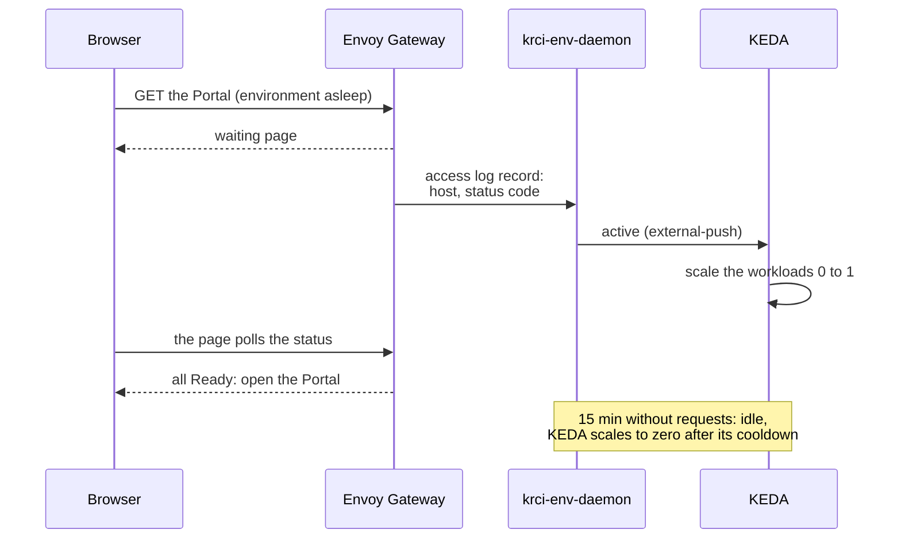
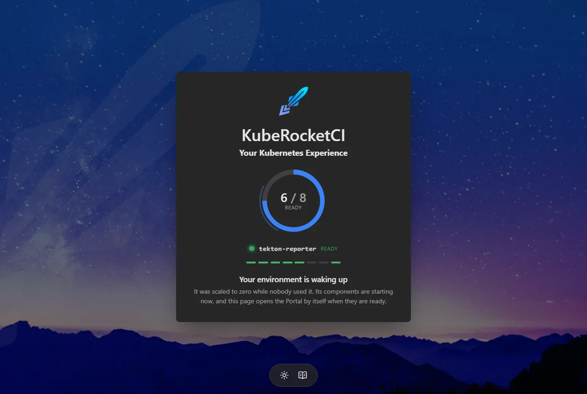

# Scale-to-Zero Kubernetes Environments with KEDA and Envoy Gateway

You keep dozens of environments on one cluster: one per team, one per QA, UAT or staging stage, one for every guest. Most of them sit idle most of the day, and every idle environment still holds its pods, its resource requests and its share of the node bill. KubeRocketCI ships [KEDA as a platform add-on](https://github.com/epam/edp-cluster-add-ons/tree/main/clusters/core/addons/keda), and it can scale them to zero. The hard part is bringing one back the moment a person opens it.

KubeRocketCI does that with [krci-env-daemon](https://github.com/KubeRocketCI/krci-env-daemon), a small open-source component that reads the Envoy Gateway access log, wakes a sleeping environment through KEDA on its first request, and shows a waiting page that opens the Portal by itself once everything is Ready. In a KubeRocketCI cluster it comes down to three add-on switches.

Every number below comes from a real run: a KubeRocketCI environment on Amazon EKS and the local [try-kuberocketci testbed](/blog/try-kuberocketci-locally).

<!--truncate-->

## Why Do Idle Environments Cost So Much?

**Because their pods keep running whether anyone uses them or not.** In a KubeRocketCI environment KEDA scales five Deployments: the Portal, the codebase and CD pipeline operators, the Tekton interceptor and the EventListener of the Git provider. Together they request about 0.2 vCPU and 0.4 GiB, and that is what multiplies:

| Environments | Pods KEDA can stop | CPU requests | Memory requests |
|---|---|---|---|
| 1 | 5 | 0.2 vCPU | 0.4 GiB |
| 20 | 100 | 4 vCPU | 8 GiB |
| 100 | 500 | 20 vCPU | 41 GiB |

A class that meets eight hours a day, five days a week, uses its environments 40 of the 168 hours in a week. On the back of an envelope, 76% of the week those requests and 500 pods are reserved for nobody.

What KEDA needs is a signal that someone wants an environment back, and that signal has to survive a change of data plane. The [classic setup](/docs/operator-guide/kubernetes-cluster-scaling/namespace-and-cluster-autoscaling) counts NGINX Ingress requests in Prometheus. Behind [Envoy Gateway](/blog/migrate-nginx-ingress-to-envoy-gateway) that metric is gone, and a request to a sleeping environment never reaches a pod, so nothing counts it.

| Approach | In the request path | Needs |
|---|---|---|
| Prometheus trigger on ingress metrics | No | Prometheus and NGINX Ingress metrics; stops working behind Envoy Gateway |
| [KEDA HTTP Add-on](https://github.com/kedacore/http-add-on) | Yes, its interceptor proxies every request | the interceptor and its scaler |
| krci-env-daemon | No, it reads a copy of the access log | Envoy Gateway 1.9 or later, KEDA 2.17 or later |

## How Does krci-env-daemon Wake an Environment?

**Envoy Gateway tells the daemon who is knocking, and KEDA does the rest.** Envoy already sees every request, so it is the natural sensor: its [OpenTelemetry access log sink](https://gateway.envoyproxy.io/docs/tasks/observability/proxy-accesslog/) sends the daemon two fields of each request, the host and the status code. The daemon maps the host to an environment through the environment's HTTPRoutes and reports the environment active to KEDA through the [external-push scaler](https://keda.sh/docs/2.21/scalers/external-push/):



The design rests on a few deliberate choices:

- **Not in the request path.** Envoy routes to the pods exactly as before and only sends the daemon a copy of its log. If the daemon stops, awake environments keep serving; only waking pauses.
- **KEDA owns the replicas.** The daemon is a KEDA external-push scaler: it answers "active" or "idle", KEDA decides the replica count, and GitOps never fights the sleeping state.
- **Pipelines count as use.** A Tekton pipeline that starts in a sleeping environment wakes it, and a running one keeps it awake.
- **Ordered start.** The annotation `krci.epam.com/wake-after: tekton-interceptor` starts the EventListeners only after the interceptor is Ready.
- **Restart-safe.** Each environment's state lives in a Kubernetes Lease, so a restart of the daemon neither wakes nor stops anything.

## What Does a Visitor See?

Instead of an error, the visitor gets a page that shows the environment starting, workload by workload:



Envoy serves it through a `BackendTrafficPolicy` on the environment's route while the route has no ready endpoints, and when every workload is Ready the page opens the URL the visitor asked for. On Amazon EKS a KubeRocketCI environment with ten workloads woke in 23 seconds. The wake began within a second of the first request, and the Portal answered at 31 seconds.

## How Much Does It Cost to Run?

Very little, and it grows slowly with the number of environments. Measured on the testbed:

| Scenario | CPU | Memory |
|---|---|---|
| One environment, asleep | 0.9 mCPU | 11 MiB |
| One environment, waking | 4.6 mCPU average, 26 mCPU peak | 11 MiB |
| 51 environments, read access per namespace | 13.6 mCPU | 49 MiB |
| 51 environments, cluster-wide read access | 11.5 mCPU | 25 MiB |

That is about 0.7 MiB per environment with a Role in each namespace, or 0.25 MiB with cluster-wide reads, so a hundred environments come to about 80 MiB. The access log is cheap too: at 2,000 requests per second it cost Envoy about 18 µs and the daemon about 8 µs of CPU per request, with no records dropped.

## How Do You Turn It On in KubeRocketCI?

You need the Portal served through Envoy Gateway (see the [migration post](/blog/migrate-nginx-ingress-to-envoy-gateway)) and these add-ons from [edp-cluster-add-ons](https://github.com/epam/edp-cluster-add-ons): `envoy-gateway`, `envoy-gateway-resources`, `keda` and `keda-tenants`. Then flip three switches, in this order.

**1. Run the daemon** and list the environments it serves:

```yaml title="clusters/core/apps/values.yaml (excerpt)"
krci-env-daemon:
  createNamespace: true
  enable: true
  namespace: krci-env-daemon
```

```yaml title="clusters/core/addons/krci-env-daemon/values.yaml"
krci-env-daemon:
  idle: 15m
  environments:
    - namespace: krci
      route: krci-portal
      hostnames:
        - krci-portal-krci.example.com
```

`namespace` gives the daemon read access; `route` and `hostnames` add the waiting page to the environment's Portal.

**2. Send it the access log:**

```yaml title="clusters/core/addons/envoy-gateway-resources/values.yaml"
krciEnvDaemon:
  enabled: true
```

**3. Switch the KEDA trigger** of the tenant namespaces:

```yaml title="clusters/core/addons/keda-tenants/values.yaml (excerpt)"
kedaTenants:
  namespaces:
    - krci
trigger: krci-env-daemon
```

To turn it off, go in reverse order. While a ScaledObject points at a daemon that is not running, KEDA keeps the workload at its current replicas. After the sync the daemon logs one `adopted` line per environment; open the Portal of a sleeping environment and the waiting page appears.

**Not on KubeRocketCI?** The daemon is a standalone Helm chart. Any namespace with an HTTPRoute on the Gateway can sleep: list it in `environments` and give each Deployment a ScaledObject with the daemon's label and trigger:

```yaml title="ScaledObject for any workload"
apiVersion: keda.sh/v1alpha1
kind: ScaledObject
metadata:
  name: web
  namespace: team-a
  labels:
    krci.epam.com/env-daemon: enabled
spec:
  scaleTargetRef:
    name: web
  minReplicaCount: 0
  maxReplicaCount: 1
  cooldownPeriod: 300
  triggers:
    - type: external-push
      metadata:
        scalerAddress: krci-env-daemon.krci-env-daemon.svc:9090
```

## Where Does Scale-to-Zero Pay Off?

The more environments you run and the less each one is used, the more it saves:

| Use case | How it is used | What scale-to-zero changes |
|---|---|---|
| Workshops and training courses | a hundred or more participants, each with their own environment, busy during sessions | the cluster pays for hours, not the calendar |
| Collaboration with other teams | penetration testers or another team get their own environments for a few weeks | every guest team works in isolation, and its environments sleep between sessions |
| Showcases | an environment for a customer demo or a public showcase, opened now and then | ready the moment a guest opens it, asleep the rest of the time |
| QA, UAT and staging environments | opened a few times a day by a few people | always available, paid for when someone opens one |
| Rarely visited environments | support reproductions, long-lived feature environments | kept on the cluster at near-zero cost |

**Every member and every guest gets their own environment.** That is the difference between one shared demo and a separate platform per person that waits at zero until its owner logs in. Short-lived [preview environments](/blog/ephemeral-preview-environments-kubernetes-feature-branch) gain too: one that lives for a few days sleeps between reviews.

## Built Security-First

The daemon takes traffic from the gateway and holds a Kubernetes token, so its security review came before the first release, not after it:

- **Attack-tested before release.** The access-log receiver, the KEDA scaler, the waiting page and every input a tenant controls were tested as attack surfaces on a throwaway cluster; each finding was fixed and re-tested before the first release.
- **Bounded by default.** Size, connection and handshake limits on the listeners, and caches that keep only the fields the daemon reads, so no tenant can grow its memory.
- **Least privilege.** Read-only access to the environments through a Role in each namespace, and a hostname that belongs to the route the Gateway accepted first.
- **Closed by default.** A NetworkPolicy for the Envoy and KEDA namespaces only, closed metrics, an admin API on loopback, a distroless non-root image, and a waiting page with a strict Content Security Policy.
- **Gated releases.** Linters, unit tests, Helm checks, a SonarQube quality gate and CodeQL on every change, Dependabot for dependencies, and a [cosign](https://github.com/sigstore/cosign) signature with an attestation in Rekor on every release image.

## What Are the Limits?

- **A cold start takes 20 to 30 seconds.** The waiting page covers it, and the Portal opens by itself.
- **The first webhook is not delivered.** A webhook that reaches a sleeping environment wakes it but gets an error; redeliver it from the Git provider, or push again, once the environment is up.
- **Any request counts as use.** An open Portal tab keeps its environment awake, and anyone who can reach a hostname can wake it - and do nothing more.
- **An outside deploy does not wake it.** A GitOps sync that recreates the workloads of a sleeping environment waits until something wakes it, so send one request to the environment's host first.
- **Envoy Gateway only.** Only exact hostnames of HTTPRoutes the Gateway accepted count.
- **One replica.** If the daemon is down, waking stops; serving does not.

## Frequently Asked Questions

### Does krci-env-daemon proxy my traffic?

No. Envoy keeps routing every request straight to the pods; the daemon only reads a copy of the access log with the host and status code of each request.

### What happens if krci-env-daemon goes down?

Awake environments keep serving, and KEDA keeps every workload at its current replicas, so nothing scales up or down until the daemon is back. A restarted daemon reads each environment's state from its Lease and carries on.

### How is it different from the KEDA HTTP Add-on?

The HTTP Add-on puts an interceptor in front of the workloads and proxies every request through it. krci-env-daemon stays out of the request path and uses the gateway you already run as its sensor.

### Can I use it without KubeRocketCI?

Yes. It is a standalone Helm chart: any namespace served through an HTTPRoute on Envoy Gateway can sleep and wake, with KEDA 2.17 or later.

## Summary

Scale-to-zero is easy to switch on and hard to live with when nothing brings an environment back. krci-env-daemon closes that gap with what the cluster already runs: Envoy Gateway as the sensor, KEDA as the only owner of replicas, and a waiting page instead of an error.

On a real environment the wake took 23 seconds from the first request. The daemon used 11 MiB with an environment asleep and under 50 MiB for 51 of them. A training class of a hundred environments stops holding 500 pods and 20 vCPU of requests outside class hours.

Next steps from here:

- Read the code, the full list of limits and the standalone install in [krci-env-daemon](https://github.com/KubeRocketCI/krci-env-daemon).
- Turn it on with the add-ons in [edp-cluster-add-ons](https://github.com/epam/edp-cluster-add-ons); the [add-ons overview](/docs/operator-guide/add-ons-overview) explains the catalog.
- Still on NGINX Ingress? Start with [Migrating from NGINX Ingress to Envoy Gateway](/blog/migrate-nginx-ingress-to-envoy-gateway).
- New to the platform? Start with [What is KubeRocketCI](/docs/about-platform) or [try it locally](/blog/try-kuberocketci-locally).

KubeRocketCI is open source under Apache License 2.0. The platform, Helm charts, and add-ons are all on [GitHub](https://github.com/KubeRocketCI).

{/* cspell:ignore sablier */}
