<!-- markdownlint-disable MD025 -->

import Tabs from '@theme/Tabs';
import TabItem from '@theme/TabItem';

# SonarQube Integration

<head>
  <link rel="canonical" href="https://docs.kuberocketci.io/docs/operator-guide/code-quality/sonarqube" />
</head>

This documentation offers detailed guidance on seamlessly integrating SonarQube into KubeRocketCI.
It covers essential steps to ensure a robust connection between SonarQube's code quality and security
analysis capabilities with the platform's continuous delivery ecosystem,
facilitating enhanced code inspection and improvement practices within your development workflow.

<div style={{ display: 'flex', justifyContent: 'center' }}>
<iframe width="560" height="315" src="https://www.youtube-nocookie.com/embed/0duxqmIKFpQ" title="SonarQube Integration" frameborder="0" allow="accelerometer; autoplay; clipboard-write; encrypted-media; gyroscope; picture-in-picture" allowfullscreen="allowfullscreen"></iframe>
</div>

## Prerequisites

Before proceeding, ensure the following prerequisites are in place:

- Kubectl version 1.34.0+ is installed. Please refer to the [Kubernetes official website](https://kubernetes.io/releases/download/) for details.
- [Helm](https://helm.sh) version 3.19.0+ is installed. Please refer to the [Helm page](https://github.com/helm/helm/releases) on GitHub for details.

## Installation

To install SonarQube in environment, it's recommended to use the resources provided in the [Cluster Add-Ons](https://github.com/epam/edp-cluster-add-ons) repository. This approach involves installing both the sonarqube and the [sonar-operator](https://github.com/epam/edp-sonar-operator). Leveraging the Cluster Add-Ons simplifies the deployment and management process, providing a streamlined method to integrate SonarQube into infrastructure.

1. Navigate to the forked cluster Add-Ons repository and align the [sonar values.yaml](https://github.com/epam/edp-cluster-add-ons/tree/main/clusters/core/addons/sonar/values.yaml) and [sonar-operator values.yaml](https://github.com/epam/edp-cluster-add-ons/tree/main/clusters/core/addons/sonar-operator/values.yaml) files. Follow the instructions to deploy sonarqube, ensuring it's correctly configured to serve as artifact repository.

2. Update the configuration to enable **sonar** and **sonar-operator** in [Add-Ons](https://github.com/epam/edp-cluster-add-ons/blob/main/clusters/core/apps/values.yaml) repository:

    ```yaml title="clusters/core/apps/values.yaml"
    sonar:
      createNamespace: true
      enable: true

    sonar-operator:
      createNamespace: true
      enable: true
    ```

3. Sync resources and wait till the all **sonar** and **sonar-operator** resources is created:

    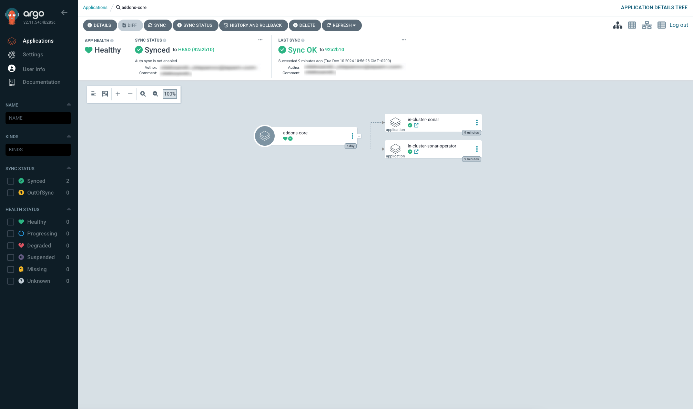

4. **Sign In** into **sonarqube** using the default credentials **Username**: `admin` and **Password**: `admin` and update the default password for better security for that click on profile icon in the upper right corner, click on **Security**, enter a new password and click **Update** button:

    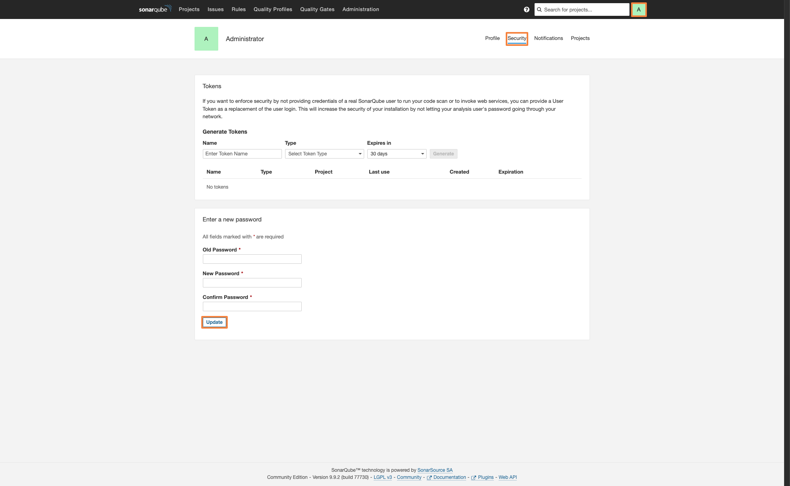

### Applying GitOps approach installation changes

To update SonarQube configurations:

1. Modify the relevant configuration files in the forked add-ons repository.
2. Commit and push the changes to the forker Git repository.
3. Synchronize the changes with ArgoCD.

## Configuration

With Add-ons approach add predefined [SonarQube plugins](https://github.com/epam/edp-cluster-add-ons/blob/build/0.1.0-SNAPSHOT.236/clusters/core/addons/sonar/values.yaml#L26) and [sonar-operator](https://github.com/epam/edp-cluster-add-ons/tree/build/0.1.0-SNAPSHOT.236/clusters/core/addons/sonar-operator/templates/sonar) create the necessary groups, users, permission templates, quality profiles, quality gates automatically by deploy preconfigured custom resources. Manage these configurations centrally through a GitOps-based workflow.

## Configuration SonarQube with sonar-operator

1. Create a Kubernetes Secret that the **sonar-operator** will use to connect to the **sonarqube** and create all resources:

  <Tabs
    defaultValue="manifests"
    values={[
      {label: 'Manifests', value: 'manifests'},
      {label: 'External Secrets Operator', value: 'externalsecret'},
    ]}>
    <TabItem value="manifests">
      ```yaml
      apiVersion: v1
      kind: Secret
      metadata:
        name: sonar-admin-password
        namespace: sonar
      type: Opaque
      data:
        user: YWRtaW4=     # base64-encoded value of "admin"
        password: cGFzcw== # base64-encoded value of "pass"
      ```
    </TabItem>
    <TabItem value="externalsecret">
      ```json
      "sonarqube":
      {
        "user": "XXXXXXX",
        "password": "XXXXXXX"
      }
      ```
      </TabItem>
  </Tabs>

2. Create a secret using `manifests` or with `External Secrets Operator` to enable the **sonar-operator** to connect to the **sonarqube** for provisioning:

  <Tabs
    defaultValue="manifests"
    values={[
      {label: 'Manifests', value: 'manifests'},
      {label: 'External Secrets Operator', value: 'externalsecret'},
    ]}>
    <TabItem value="manifests">
      ```yaml
      apiVersion: v1
      kind: Secret
      metadata:
        name: ci-sonar
        namespace: sonar
      type: Opaque
      stringData:
        password: <sonar-ci-password>
      ```
    </TabItem>
    <TabItem value="externalsecret">
      ```json
      "sonarqube-ci-user":
      {
        "password": "XXXXXXX"
      }
      ```
      </TabItem>
  </Tabs>

## SonarQube configuration overview with sonar-operator

### Plugin Management

The SonarQube instance includes pre-installed plugins to meet common project needs. Additional plugins, if required, can be installed by updating the [SonarQube values.yaml](https://github.com/epam/edp-cluster-add-ons/blob/build/0.1.0-SNAPSHOT.236/clusters/core/addons/sonar/values.yaml#L26) file in the forked add-ons repository.

### Group Permissions

Access control in SonarQube is organized through predefined groups:

- **sonar-administrators:** System administrators with full access to manage the instance.
- **sonar-developers:** Developers who can view and edit project settings (managed by the Sonar Operator).
- **sonar-users:** Default group for all authenticated users with basic project viewing rights.
- **view-group:** Grants browsing access for users requiring read-only permissions.

    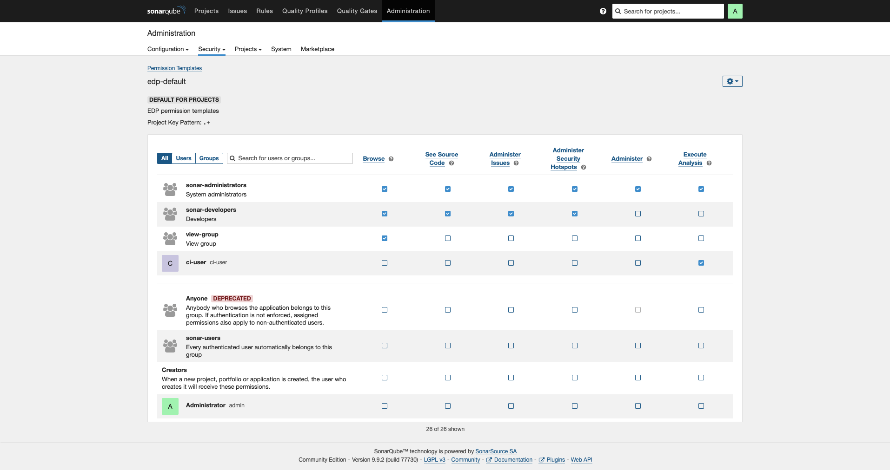

### Permission Templates

Permissions in SonarQube are associated with projects through permission templates:

- **edp-default:** The default template applied to all projects, ensuring consistent group-level access management across the platform.

### Quality Gates

Quality Gates are used to ensure that code quality standards are met before further development or deployment proceeds:

- **KubeRocketCI way (default):** KuberocketCI quality gates are defined in the SonarQube instance, specifically tailored for the KubeRocketCI project.
- **Sonar way (built-in):** These are predefined quality gates available directly in SonarQube, not customized for any specific project but rather standardized for general use.

    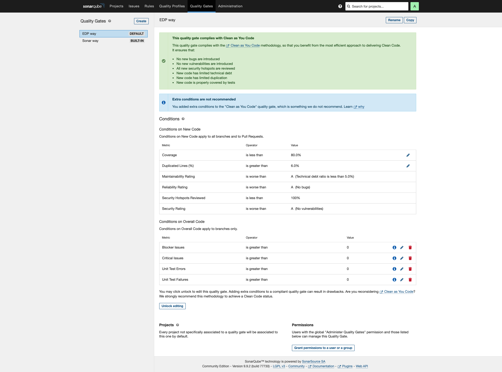

### Quality Profiles

Quality Profiles define the rules used during code analysis. The Sonar Operator manages quality profiles with the following default setup:
- **KubeRocketCI way (default):** A Java quality profile based on KubeRocketCI best practices, offering tailored rule sets.

## Configuration SonarQube ci-user without sonar-operator

To establish robust authentication and precise access control, generating a SonarQube token is essential. This token is a distinct identifier, enabling effortless integration between SonarQube and KubeRocketCI. To generate the SonarQube token, proceed with the following steps:

1. Open the SonarQube UI and navigate to **Administration** -> **Security** -> **User**. Create a new user or select an existing one. Click the `Options List` icon to create a token:

    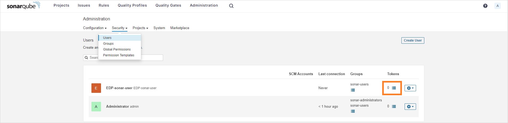

2. Type the `ci-user` username, define an expiration period, and click the `Generate` button to create the token:

    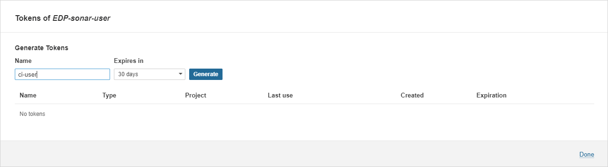

3. Click the `Copy` button to copy the generated `<Sonarqube-token>`:

    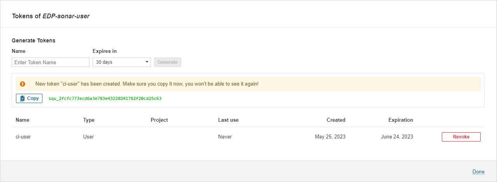

## Integrate SonarQube With KubeRocketCI

For provision secret using manifest, KubeRocketCI portal or with the externalSecrets operator:

<Tabs
  defaultValue="kuberocketci"
  values={[
    {label: 'KubeRocketCI portal', value: 'kuberocketci'},
    {label: 'Manifests', value: 'manifests'},
    {label: 'External Secrets Operator', value: 'externalsecret'},
  ]}>

  <TabItem value="kuberocketci">
  Go to the **Portal** open **Configuration** -> **Code Quality** -> **SonarQube**. Update or click **+ Add integration** fill in the `URL` and `Token` fields and click the `Save` button:

  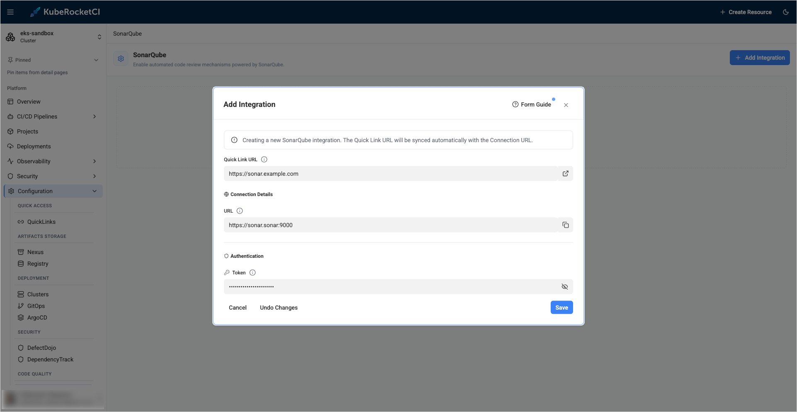
  </TabItem>

  <TabItem value="manifests">

  ```yaml
  apiVersion: v1
  kind: Secret
  metadata:
    name: ci-sonarqube
    namespace: krci
    labels:
      app.edp.epam.com/secret-type: sonar
      app.edp.epam.com/integration-secret: "true"
  type: Opaque
  stringData:
    url: https://sonarqube.example.com
    token: <sonarqube-token>
  ```

  </TabItem>

  <TabItem value="externalsecret">

  ```json
  "ci-sonarqube":
  {
    "url": "https://sonarqube.example.com",
    "token": "XXXXXXXXXXXX"
  },
  ```

  Go to the **Portal** open **Configuration** -> **Code Quality** -> **SonarQube** and see the `Managed by External Secret` message:

  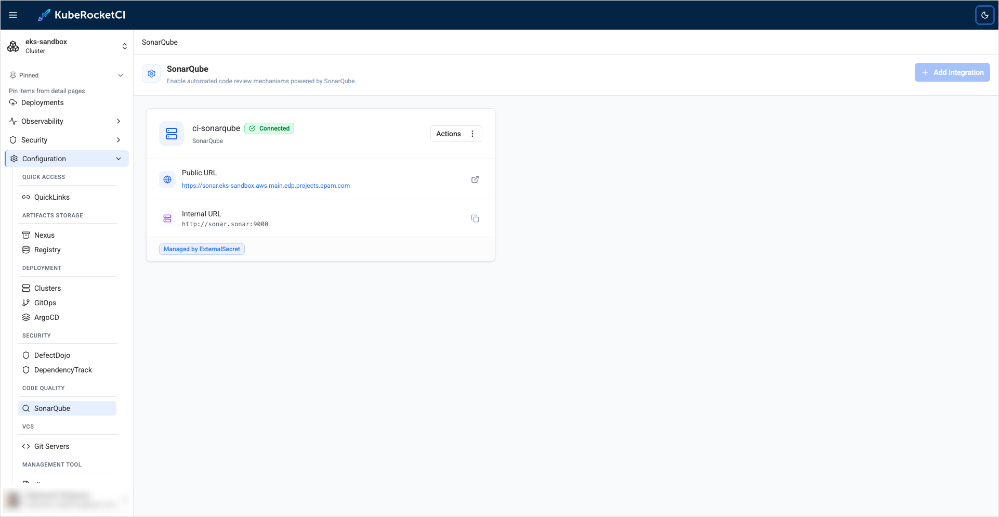

  More details about External Secrets Operator integration can be found in the [External Secrets Operator Integration](https://epam.github.io/edp-install/operator-guide/code-quality/external-secrets-operator-integration/) page.
  </TabItem>

</Tabs>

## Use SonarCloud

The pipelines work with SonarCloud (SonarQube Cloud), the hosted edition of SonarQube, in the same way as with a self-hosted SonarQube. The integration uses the same `ci-sonarqube` secret. The pipelines choose the mode from the host name of its URL: `sonarcloud.io` selects SonarCloud in the EU region, `sonarqube.us` selects SonarCloud in the US region, and any other host selects SonarQube. The behavior with a self-hosted SonarQube does not change.

SonarCloud differs from a self-hosted SonarQube in the following ways:

- SonarCloud does not create projects automatically. Import the repository into SonarCloud before the first analysis.
- The pipelines do not set the project key and the organization. The scanner reads them from the project configuration, and the pipelines ignore the codebase name as the project key.
- The key of a project imported from GitHub is `<owner>_<repository>`. The `<owner>` part is the name of the GitHub account or organization written exactly as it is on GitHub, including the letter case. It is not the SonarCloud organization key. For example, for the repository `my-app` of the GitHub organization `Octo-Org`, the project key is `Octo-Org_my-app`, while the SonarCloud organization key can be `octo-org`.

To use SonarCloud, follow these steps:

1. Import the repository into your SonarCloud organization and disable **Automatic Analysis** for the project: open the project, go to **Administration** -> **Analysis Method**, and turn off **Automatic Analysis**. A pipeline analysis fails with the `You are running manual analysis while Automatic Analysis is enabled` error if Automatic Analysis stays on. For details on creating the organization and the token, see [Integrate SonarCloud with KubeRocketCI Pipelines](../../quick-start/integrate-sonarcloud.md).

2. Add the integration as described in [Integrate SonarQube With KubeRocketCI](#integrate-sonarqube-with-kuberocketci). Set the `URL` field to `https://sonarcloud.io` and the `Token` field to the SonarCloud token. The secret holds only the `url` and `token` keys. No other keys are needed.

3. Add the project key and the organization key to the project configuration in the repository. Use the format that the scanner of the language expects. Find the organization key in the SonarCloud organization settings, in the **Key** field, not in the **Name** field.

<Tabs
  defaultValue="general"
  values={[
    {label: 'Go and other languages', value: 'general'},
    {label: 'Java Maven', value: 'maven'},
    {label: 'Java Gradle', value: 'gradle'},
    {label: '.NET', value: 'dotnet'},
  ]}>

  <TabItem value="general">

  Add the keys to `sonar-project.properties` in the repository root. The pipelines do not overwrite `sonar.projectKey` of this file in SonarCloud mode:

  ```properties title="sonar-project.properties"
  sonar.projectKey=<owner>_<repository>
  sonar.organization=<organization-key>
  ```

  If the file or one of the keys is missing, the `prepare-sonar-project-properties` step fails with a message that names the missing key.

  </TabItem>

  <TabItem value="maven">

  Add the keys to the `properties` section of `pom.xml`:

  ```xml title="pom.xml"
  <properties>
    <sonar.projectKey><owner>_<repository></sonar.projectKey>
    <sonar.organization><organization-key></sonar.organization>
  </properties>
  ```

  The pipelines remove the `-Dsonar.projectKey` option that sets the codebase name, because a command-line option takes precedence over `pom.xml`.

  </TabItem>

  <TabItem value="gradle">

  Add the keys to the `sonarqube` block of `build.gradle`:

  ```groovy title="build.gradle"
  sonarqube {
    properties {
      property 'sonar.projectKey', '<owner>_<repository>'
      property 'sonar.organization', '<organization-key>'
    }
  }
  ```

  The pipelines remove the `sonar.projectKey` system property that sets the codebase name, because a system property takes precedence over `build.gradle`.

  </TabItem>

  <TabItem value="dotnet">

  The `begin` command of the SonarScanner for .NET accepts the project key and the organization only as command-line arguments, so the project has no standard place for them. Add the keys to the `SonarQube.Analysis.xml` settings file of the scanner in the repository root. The pipelines read them from this file and pass them to the `begin` command:

  ```xml title="SonarQube.Analysis.xml"
  <SonarQubeAnalysisProperties>
    <Property Name="sonar.projectKey"><owner>_<repository></Property>
    <Property Name="sonar.organization"><organization-key></Property>
  </SonarQubeAnalysisProperties>
  ```

  :::warning

  Do not add `sonar-project.properties` to a .NET repository. The SonarScanner for .NET stops with the `sonar-project.properties files are not understood by the SonarScanner for MSBuild` error if the file exists.

  :::

  </TabItem>

</Tabs>

4. Run a review pipeline and open the project in SonarCloud to see the analysis of the pull request.

If a pipeline fails, check the following:

- The `Sonar is not available` message means that the SonarCloud URL in the secret is wrong or SonarCloud cannot be reached from the cluster.
- A message that SonarCloud requires `sonar.projectKey` or `sonar.organization` means that the key is missing from the project configuration of the language.
- A `Could not find project` or `project not found` error from the scanner usually means that the key does not match the key of the imported project. Check the letter case of the GitHub owner name.
- A `Failed to query server version` error means that a scanner got `sonar.host.url=https://sonarqube.us`, for example from a custom pipeline. Remove the option: the scanners connect to SonarQube Cloud on their own, see [SonarQube Cloud US region](#sonarqube-cloud-us-region).
- A 401 or 403 error, or a `project not found` error, for a project of the US region usually means that the scanner contacted the EU region. Check that the `URL` field is `https://sonarqube.us` and that the token was created in the US region.

### SonarQube Cloud US region

For an organization in the US region of SonarQube Cloud, set the `URL` field of the integration to `https://sonarqube.us` and use a token created in that region. Organizations and tokens of the EU and US regions are separate. Everything else works as described above.

The scanners connect to SonarQube Cloud on their own and choose the region by the `sonar.region` parameter. The pipelines pass `sonar.region=us` and do not pass `sonar.host.url`, because with `sonar.host.url=https://sonarqube.us` a scanner treats the server as a SonarQube Server and fails. The US region requires at least these scanner versions:

- SonarScanner CLI 7.1.0.4889, used by the pipelines of Go and other languages.
- SonarScanner for Maven 5.1.0.4751.
- SonarScanner for Gradle 6.1.0.5360. The `org.sonarqube` plugin version is set in the `build.gradle` of the project.
- SonarScanner for .NET 10.1.1.

## Configure the KubeRocketCI Portal

The KubeRocketCI Portal reads SonarQube data for the **Code Quality** tab of a project and for the SAST pages. It uses its own connection, separate from the `ci-sonarqube` secret that pipelines use.

1. Use a SonarQube token of a user that has the `Browse` and `View Issues` permissions on the projects. The `ci-user` token from the previous section can be used.

2. Set the SonarQube URL in the `krci-portal` values:

    ```yaml
    krci-portal:
      configEnv:
        SONAR_HOST_URL: https://sonarqube.example.com
        # Optional: browser-facing URL, when it differs from SONAR_HOST_URL
        SONAR_WEB_URL: https://sonarqube.example.com/
    ```

3. Add the token to the Portal secret as `SONAR_TOKEN` (see [Create the portal-secret Kubernetes Secret](../upgrade/upgrade-krci-3.13.md#62-create-the-portal-secret-kubernetes-secret)). With the External Secrets Operator, store it under the Portal `eso.secretPath`; change the value in the external store, because the Operator overwrites manual changes of the Secret. Restart the Portal to apply the token.

4. Run a build pipeline for the codebase, then open **Projects** -> *the project* -> **Code Quality** to verify the data. The portal looks up the SonarQube project by the codebase name:

    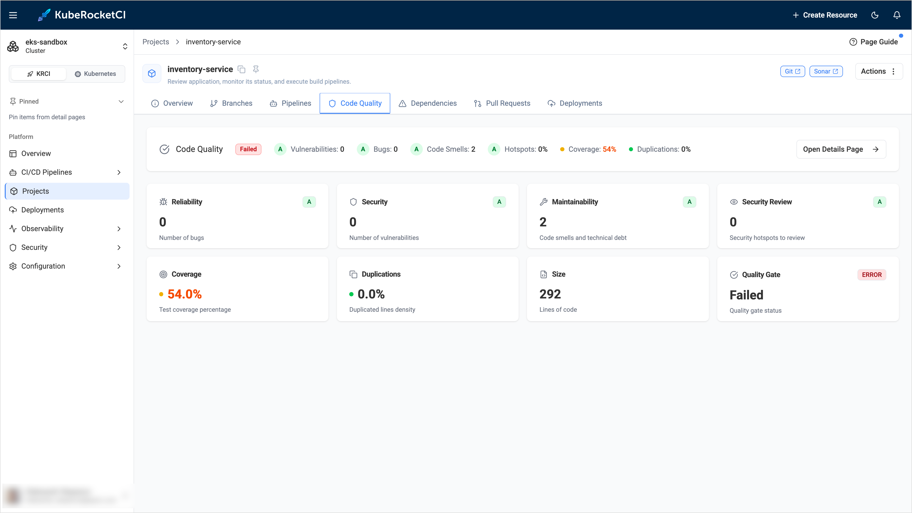

If the tab shows `SONAR_HOST_URL environment variable is not configured` or `SONAR_TOKEN environment variable is not configured`, set the missing variable and restart the Portal. If the tab shows `SonarQube upstream failure`, see [SonarQube Upstream Failure](../troubleshooting/sonarqube-upstream-failure.md).

## Project Analysis Flow

1. SonarQube analysis is seamlessly integrated into KubeRocketCI pipelines, triggered during both review and build pipelines:

- **Review Pipeline:** Analyzes only the changes made in a pull request.
- **Build Pipeline:** Analyzes the main branch codebase to ensure overall project quality.

2. SonarQube projects are named based on the corresponding KubeRocketCI project names, making it easy to navigate analysis results in the SonarQube UI mode details how to configure repo [project-project.settings](../../user-guide/application-sonarqube-project-properties.md):

    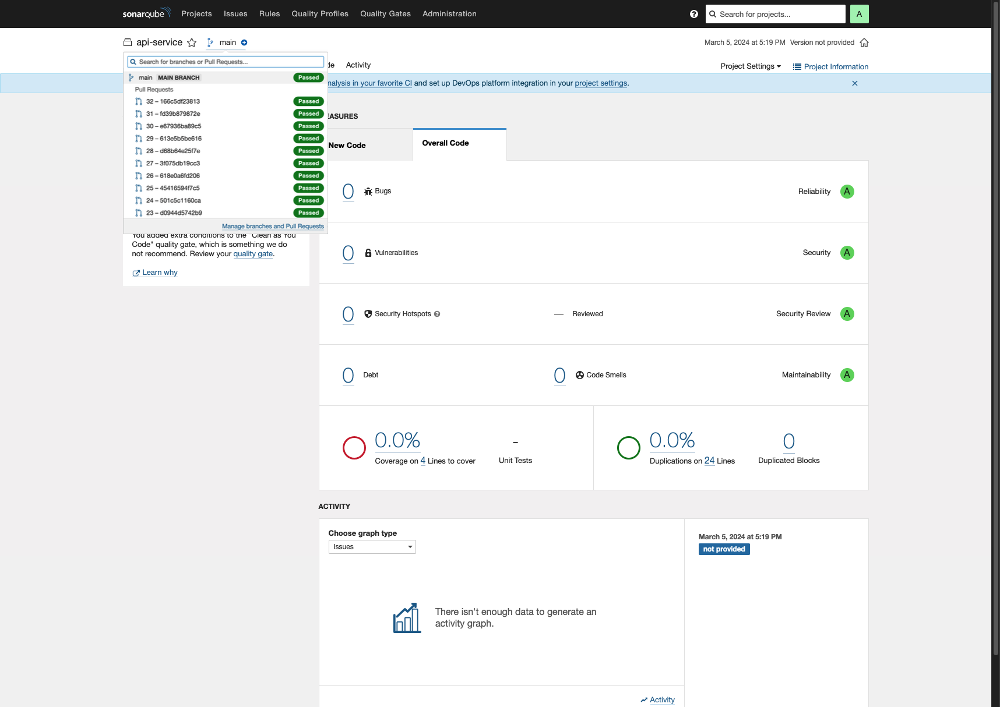

## Related Articles

* [KubeRocketCI Widgets](../../user-guide/widgets.md)
* [Publish SonarQube Reports to Pull Requests](sonarqube-pr-decoration.md)
* [Sonarqube Project Properties for Application](../../user-guide/application-sonarqube-project-properties.md)
* [Install KubeRocketCI With Values File](../install-kuberocketci.md)
* [Install External Secrets Operator](../secrets-management/install-external-secrets-operator.md)
* [External Secrets Operator Integration](../secrets-management/external-secrets-operator-integration.md)
* [Cluster Add-Ons Overview](../add-ons-overview.md)
