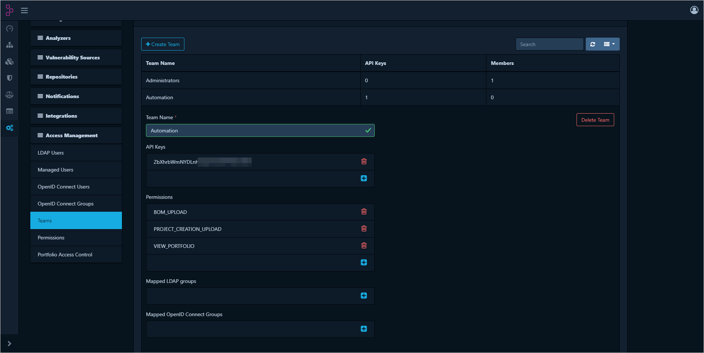
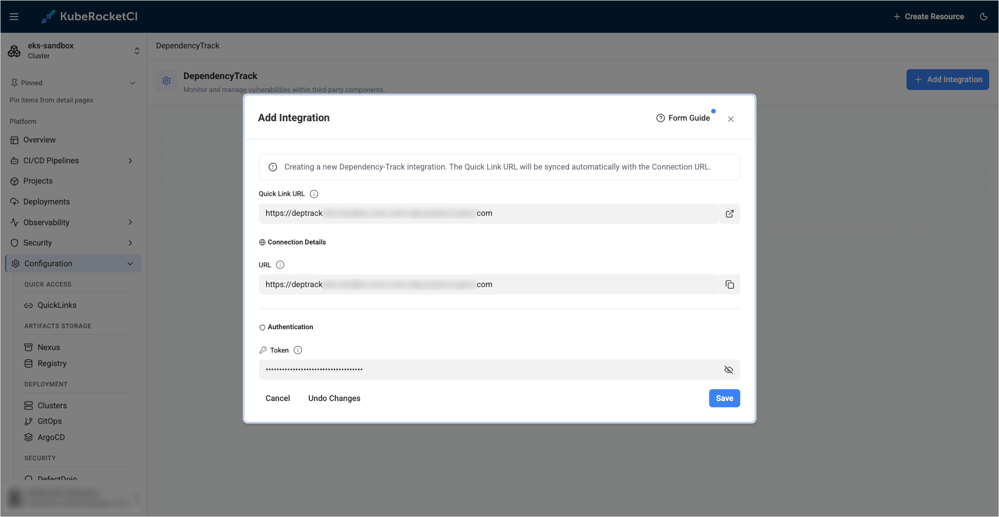
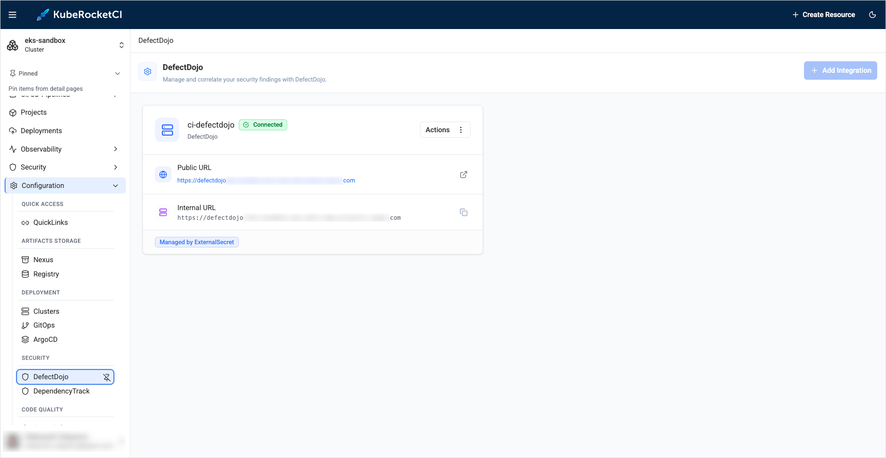
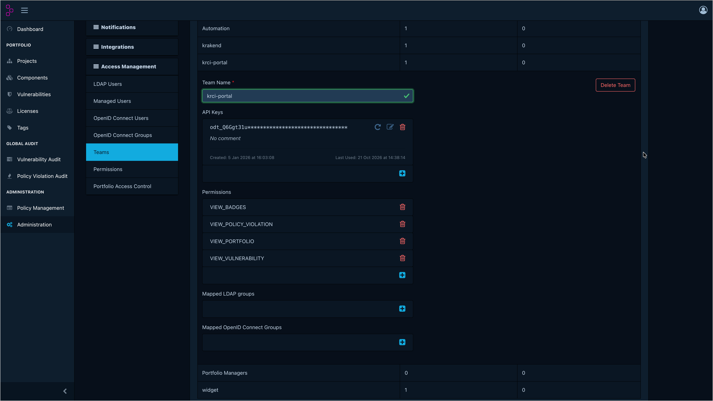
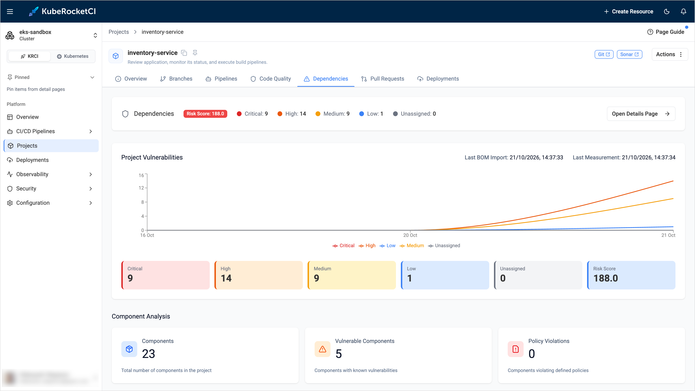

<!-- markdownlint-disable MD025 -->

import Tabs from '@theme/Tabs';
import TabItem from '@theme/TabItem';

# Integrate Dependency-Track

<head>
  <link rel="canonical" href="https://docs.kuberocketci.io/docs/operator-guide/devsecops/dependency-track" />
</head>

This documentation guide provides comprehensive instructions for installing and integrating Dependency-Track with the KubeRocketCI.

:::note
  For details on how KubeRocketCI pipelines generate SBOMs with cdxgen and upload them to Dependency-Track, refer to [Security Scanning Pipelines](./security-pipelines.md).
:::

## Prerequisites

- Kubectl version 1.34.0+ is installed. Please refer to the [Kubernetes official website](https://kubernetes.io/releases/download/) for details.
- [Helm](https://helm.sh) version 3.19.0+ is installed. Please refer to the [Helm page](https://github.com/helm/helm/releases) on GitHub for details.

## Installation

To install Dependency-Track use [KubeRocketCI addons](../add-ons-overview.md) approach.

## Configuration

1. Open **Administration** -> **Access Management** -> **Teams**. Click **Create Team** -> **Automation** and click **Create**.

2. Click **+** in **Permissions** and add:

    ```bash
    BOM_UPLOAD
    PROJECT_CREATION_UPLOAD
    VIEW_PORTFOLIO
    ```

3. Click **+** in **API keys** to create token:

    

4. Provision secrets using a manifest, Portal, or with the externalSecrets operator:

<Tabs
  defaultValue="portal"
  values={[
    {label: 'UI Portal', value: 'portal'},
    {label: 'Manifests', value: 'manifests'},
    {label: 'External Secrets Operator', value: 'externalsecret'},
  ]}>

  <TabItem value="portal">
  Go to the **Portal** open **Configuration** -> **SECURITY** -> **DEPENDENCYTRACK**. Click **+ ADD INTEGRATION** fill fields `Quick Link URL`, `URL` and `Token` click the `save` button.

  
  </TabItem>

  <TabItem value="manifests">

  ```yaml
  apiVersion: v1
  kind: Secret
  metadata:
    name: ci-dependency-track
    namespace: krci
    labels:
      app.edp.epam.com/secret-type: dependency-track
      app.edp.epam.com/integration-secret: "true"
  stringData:
    token: <dependency-track-token>
    url: <dependency-track-api-url>
  type: Opaque
  ```

  </TabItem>

  <TabItem value="externalsecret">
  Store Dependency-Track URL and Token in the AWS Parameter Store with the following format:

  ```yaml
  "ci-dependency-track":
  {
    "token": "XXXXXXXXXXXX",
    "url": "https://dependency-track.example.com"
  }
  ```

  Go to the **KubeRocketCI Portal** -> **Configuration** -> **Security** -> **DependencyTrack** see the secret managed by the `Managed by External Secret`:

  

  More detail on External Secrets Operator Integration can be found on [the following page](../secrets-management/external-secrets-operator-integration.md)
  </TabItem>

</Tabs>

The `ci-dependency-track` secret is used by the security pipelines to upload SBOMs.

## Configure the KubeRocketCI Portal

The KubeRocketCI Portal and the `krci sca` CLI commands read Dependency-Track with a separate, read-only API key. The pipeline key above is not enough: Dependency-Track requires `VIEW_VULNERABILITY` to list findings and `VIEW_POLICY_VIOLATION` to list policy violations, and answers `403` without them.

1. Open **Administration** -> **Access Management** -> **Teams**. Click **Create Team**, name it `krci-portal`, and click **Create**.

2. Click **+** in **Permissions** and add:

    ```bash
    VIEW_BADGES
    VIEW_POLICY_VIOLATION
    VIEW_PORTFOLIO
    VIEW_VULNERABILITY
    ```

    

3. Click **+** in **API keys** to create an API key for the team.

4. Set the Dependency-Track URL in the `krci-portal` values:

    ```yaml
    krci-portal:
      configEnv:
        DEPENDENCY_TRACK_URL: https://dependency-track.example.com
        # Optional: browser-facing URL, when it differs from DEPENDENCY_TRACK_URL
        DEPENDENCY_TRACK_WEB_URL: https://dependency-track.example.com
    ```

5. Add the API key to the Portal secret as `DEPENDENCY_TRACK_API_KEY` (see [Create the portal-secret Kubernetes Secret](../upgrade/upgrade-krci-3.13.md#62-create-the-portal-secret-kubernetes-secret)). With the External Secrets Operator, store it under the Portal `eso.secretPath`. Restart the Portal to apply the key.

6. Open **Projects** -> *the project* -> **Dependencies** to verify the widget. The portal looks up the Dependency-Track project by the codebase name and the default branch as the project version, so a [security pipeline](../../user-guide/tekton-pipelines.md#security-test-and-release-pipeline) must run for the default branch first and upload the SBOM. Build and review pipelines do not upload SBOMs. If the tab shows `DEPENDENCY_TRACK_URL environment variable is not configured` or `DEPENDENCY_TRACK_API_KEY environment variable is not configured`, set the missing variable and restart the Portal. For other errors, see [Dependency-Track Project Not Found](../troubleshooting/dependency-track-project-not-found.md) and [Dependencies Tab Shows Zero Vulnerabilities](../troubleshooting/dependency-track-zero-vulnerabilities.md).

    

7. Verify the integration: `krci sca list` lists the Dependency-Track projects, and `krci sca findings <codebase>` lists the findings of a codebase after its first security scan.

## Enable Vulnerability Analysis

Dependency-Track shows vulnerabilities only when an analyzer matches the components of an SBOM with known vulnerabilities. Without a working analyzer, the **Dependencies** tab shows the components but zero vulnerabilities.

1. Open **Administration** -> **Analyzers** and make sure that the **Internal** analyzer is enabled.

2. Enable the **Sonatype OSS Index** analyzer and fill in the **Registered email address** and **API token** fields. Create the token in your Sonatype account on the [Sonatype Guide token page](https://guide.sonatype.com/settings/tokens).

3. Run a [security pipeline](../../user-guide/tekton-pipelines.md#security-test-and-release-pipeline) for a codebase and open its **Dependencies** tab after a few minutes. The analysis runs asynchronously.

If the vulnerabilities do not appear, see [Dependencies Tab Shows Zero Vulnerabilities](../troubleshooting/dependency-track-zero-vulnerabilities.md).

## Related Articles

* [KubeRocketCI Widgets](../../user-guide/widgets.md)
* [Install External Secrets Operator](../secrets-management/install-external-secrets-operator.md)
* [External Secrets Operator Integration](../secrets-management/external-secrets-operator-integration.md)
* [Cluster Add-Ons Overview](../add-ons-overview.md)
* [Dependency-Track Microsoft Entra OIDC SSO](../microsoft-entra/dependency-track-authentication.md)
