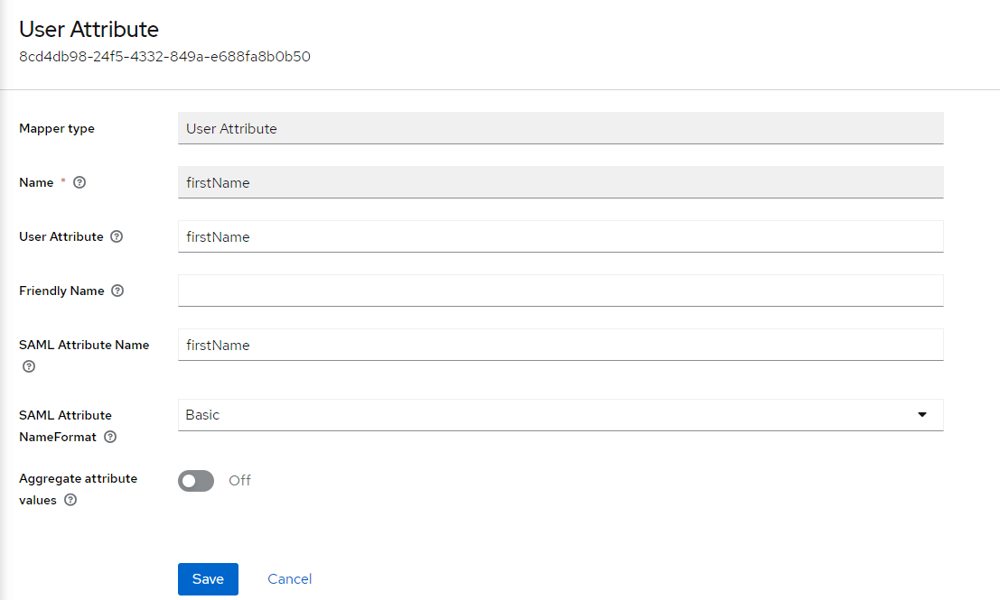
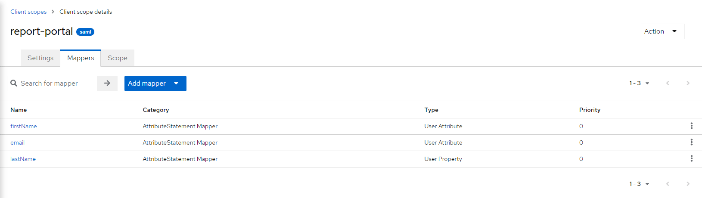
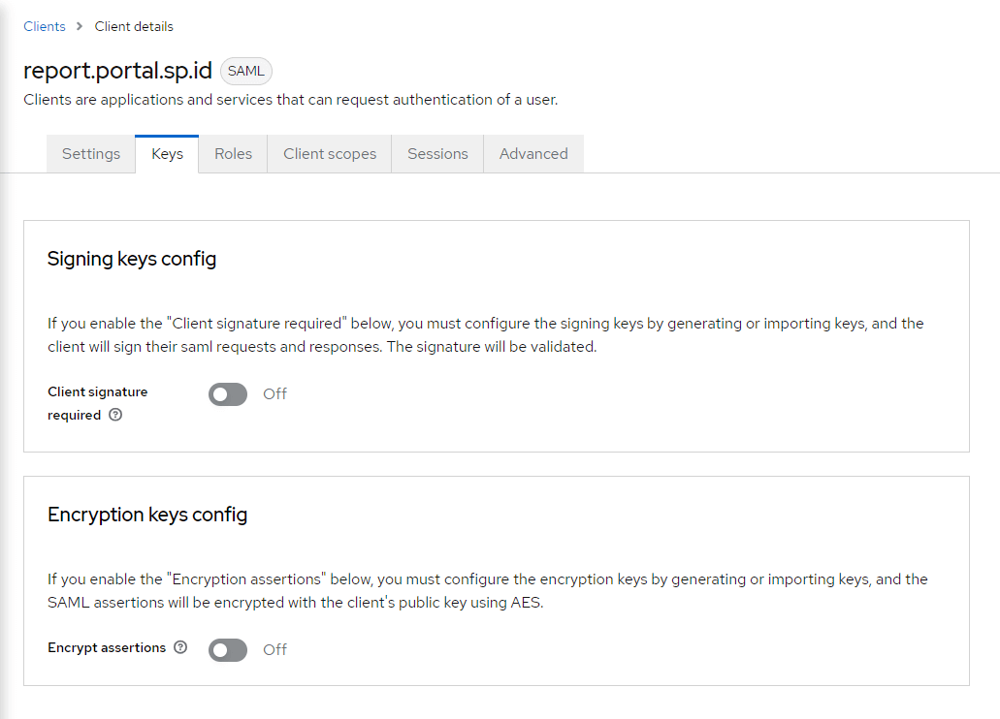
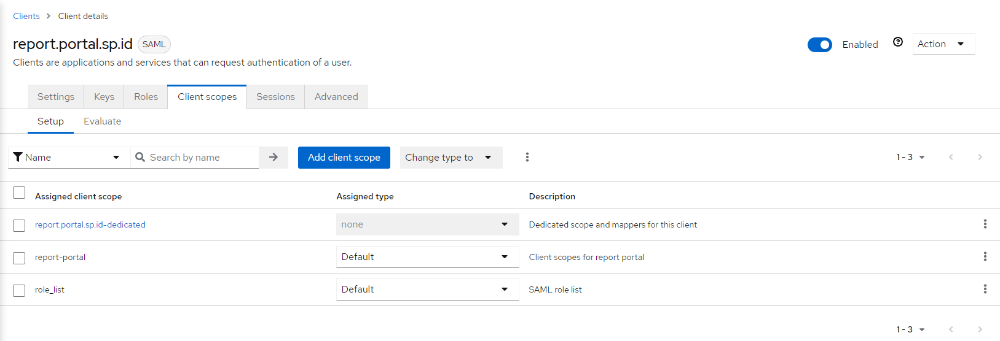
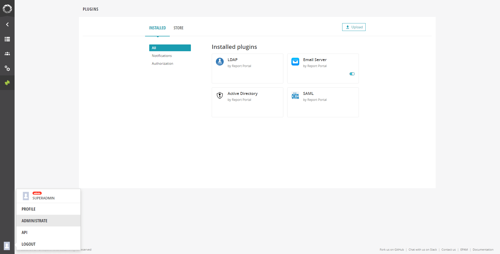
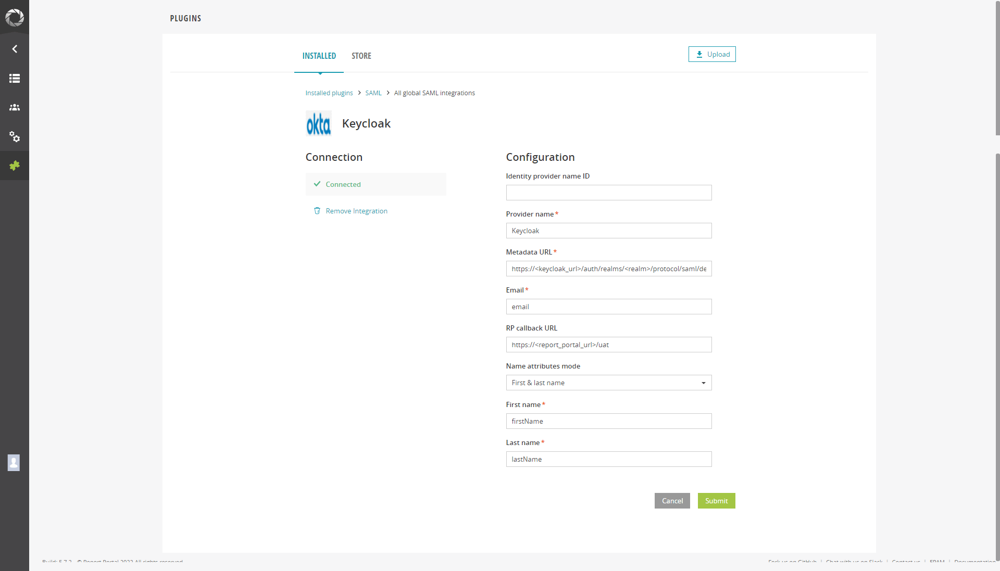
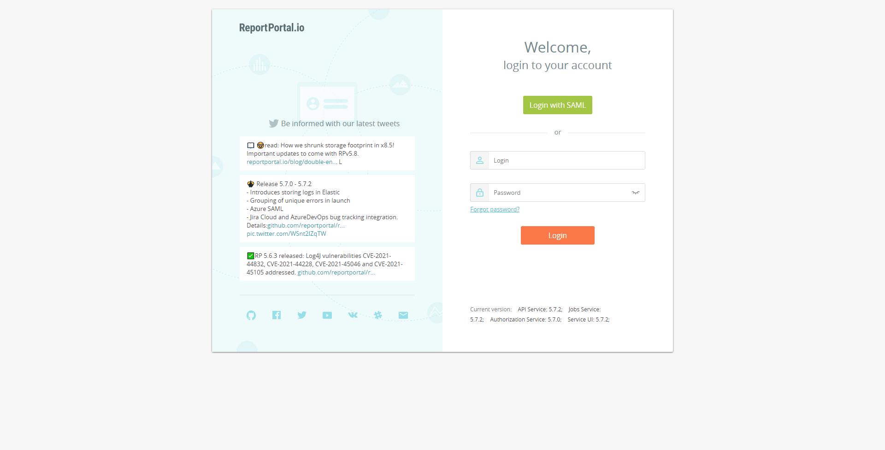

---

title: "ReportPortal SSO with Keycloak (SAML)"
description: "Configure ReportPortal single sign-on with Keycloak via SAML: Keycloak client setup and ReportPortal authentication configuration, step by step."
sidebar_label: "ReportPortal Keycloak Integration"

---
<!-- markdownlint-disable MD025 -->

# Integrating ReportPortal with Keycloak: A Step-by-Step Guide

<head>
  <link rel="canonical" href="https://docs.kuberocketci.io/docs/operator-guide/project-management-and-reporting/reportportal-keycloak" />
</head>

Configure single sign-on for ReportPortal using Keycloak as the SAML identity provider. This guide covers creating the Keycloak SAML client and enabling the integration on the ReportPortal side.

:::info
  It is also possible to install ReportPortal using the cluster add-ons. For details, please refer to the [Install via Add-Ons](../add-ons-overview.md) page.
:::

## Prerequisites

- Keycloak is installed. For detailed instructions, please refer to the provided [documentation](../auth/keycloak.md).
- ReportPortal is installed. To install it using the Helm Chart, please follow the instructions outlined in the corresponding [documentation](../project-management-and-reporting/install-reportportal.md).

## Keycloak Configuration

:::info
The Keycloak configuration can also be applied using Keycloak resources from the [Cluster Add-Ons](https://github.com/epam/edp-cluster-add-ons/tree/main/clusters/core/addons/report-portal/templates/saml) repository.
To apply the Keycloak configuration, the Keycloak Operator is required. For installation details, refer to the [Install Keycloak Operator](/docs/operator-guide/auth/eks-oidc-integration.md#install-keycloak-operator) page.
:::

1. Navigate to **Client Scopes** > **Create client scope** and create a new scope with the _SAML_ protocol type.

2. Navigate to **Client Scopes** > **your_scope_name** > **Mappers** > **Configure a new mapper** > select the _User Attribute_ mapper type. Add three mappers for the email, first name, and last name by typing `lastName`, `firstName`, and `email` in the _User Attribute_ field:

    - _Name_ is a display name in Keycloak.
    - _User Attribute_ is a user property for mapping.
    - _SAML Attribute Name_ is an attribute used for requesting information in the ReportPortal configuration.
    - _SAML Attribute NameFormat_: `Basic`.
    - _Aggregate attribute values_: `Off`.

    
    

3. Navigate to **Clients** > **Create client** and fill in the following fields:

    - _Client type_: `SAML`.
    - _Client ID_: `report.portal.sp.id`.

    :::warning
      The `report.portal.sp.id` Client ID is a constant value.
    :::

4. Navigate to **Client** > **your_client** > **Settings** and add `https://<report-portal-url>/*` to the _Valid redirect URIs_.

5. Navigate to **Client** > **your_client** > **Keys** and disable _Client signature required_.

    

6. Navigate to **Client** > **your_client** > **Client scopes** and add the scope created on step 3 with the default _Assigned type_.

    

## ReportPortal Configuration

1. Log in to the ReportPortal with the admin permissions.

2. Navigate to **Client** > **Administrate** > **Plugins** and select the SAML plugin.

    

3. To add a new integration, fill in the following fields:

    

    - _Provider name_ is the display name in the ReportPortal login page.
    - _Metadata URL_ `https://<keycloak_url>/auth/realms/<realm>/protocol/saml/descriptor`.
    - _Email_ is the value from the _SAML Attribute Name_ field in the Keycloak mapper.
    - _RP callback URL_ `https://<report_portal_url>/uat`.
    - _Name attributes mode_ is the first & last name (type based on your mapper).
    - _First name_ is the value from the _SAML Attribute Name_ field in the Keycloak mapper.
    - _Last name_ is the value from the _SAML Attribute Name_ field in the Keycloak mapper.

4. Log in to the ReportPortal.

    :::note
      By default, after the first login, ReportPortal creates the `<your_email>_personal` project and adds an account with the `Project manager` role.
    :::

    

## Sign SAML Requests (ReportPortal 26.0.x)

Keycloak requires service providers to sign SAML authentication requests (`WantAuthnRequestsSigned="true"` in its SAML metadata). By default, ReportPortal 26.0.x does not sign them, so **Login with SAML** fails and the `uat` pod logs the following error:

```text
IllegalArgumentException: Failed to resolve any signing credential
```

To enable SAML request signing, provide the `uat` service with a keystore that contains a signing key, and set the signing parameters.

:::note
  This procedure applies to ReportPortal `26.0.x`, where authentication runs in the separate `uat` deployment. The values below have no effect on versions that do not include that deployment.
:::

1. Generate a JKS keystore with the `report-portal-sp` key alias:

    ```bash
    keytool -genkeypair -alias report-portal-sp -keyalg RSA -keysize 2048 -validity 3650 \
      -dname "CN=report.portal.sp.id" -keystore keystore.jks -storetype JKS \
      -storepass '<keystore-password>' -keypass '<keystore-password>'
    ```

    :::warning
      The keystore must use the `JKS` type, as ReportPortal loads it in that format. Use a strong random password, and do not commit the keystore or the password to Git.
    :::

2. Create a Secret with the keystore and both passwords:

    ```bash
    kubectl -n <report-portal-namespace> create secret generic reportportal-saml-keystore \
      --from-file=keystore.jks=keystore.jks \
      --from-literal=keystore-password='<keystore-password>' \
      --from-literal=key-password='<keystore-password>'
    ```

    When using the External Secrets Operator, store the keystore Base64-encoded in the secret store and decode it with `decodingStrategy: Base64`.

3. Add the following to the ReportPortal Helm values:

    ```yaml
    reportportal:
      uat:
        extraEnvs:
          - name: RP_AUTH_SAML_SIGNED-REQUESTS
            value: "true"
          - name: RP_AUTH_SAML_KEY-STORE
            value: "file:///etc/saml/keystore.jks"
          - name: RP_AUTH_SAML_KEY-ALIAS
            value: "report-portal-sp"
          - name: RP_AUTH_SAML_KEY-STORE-PASSWORD
            valueFrom:
              secretKeyRef:
                name: reportportal-saml-keystore
                key: keystore-password
          - name: RP_AUTH_SAML_KEY-PASSWORD
            valueFrom:
              secretKeyRef:
                name: reportportal-saml-keystore
                key: key-password
        extraVolumes:
          - name: saml-keystore
            secret:
              secretName: reportportal-saml-keystore
              items:
                - key: keystore.jks
                  path: keystore.jks
        extraVolumeMounts:
          - name: saml-keystore
            mountPath: /etc/saml
            readOnly: true
    ```

4. Wait for the `uat` pod to restart, and then check its log. The following messages must **not** appear:

    ```text
    Skipping SAML provider
    No valid SAML providers registered
    ```

5. Log in with SAML as a user that already exists in ReportPortal. ReportPortal matches the user by email, signs in to the existing account, and does not create a duplicate account.

## Related Articles

* [Install ReportPortal](../project-management-and-reporting/install-reportportal.md)
* [Integration With Tekton](reportportal-tekton.md)
* [Install Keycloak](../auth/keycloak.md)
