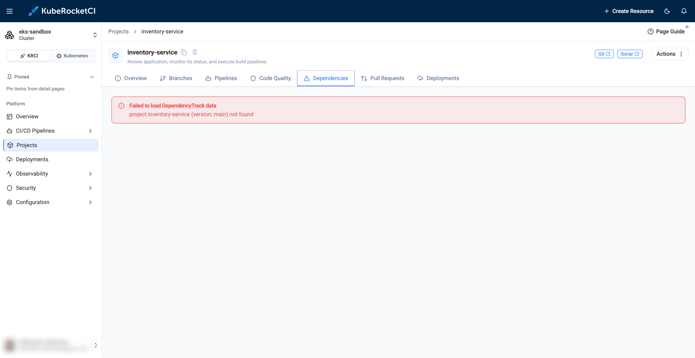

---

title: "Dependency-Track Project Not Found"
description: "Troubleshooting guidance for the Dependencies tab of a project in the KubeRocketCI portal that shows the Dependency-Track project not found error, including missing SBOM uploads."
sidebar_label: "Dependency-Track Project Not Found"

---
<!-- markdownlint-disable MD025 -->

# Dependency-Track Project Not Found

<head>
  <link rel="canonical" href="https://docs.kuberocketci.io/docs/operator-guide/troubleshooting/dependency-track-project-not-found" />
</head>

This troubleshooting page covers the error on the **Dependencies** tab of a project in the KubeRocketCI portal.

## Problem

The **Dependencies** tab shows `Failed to load DependencyTrack data` and `project <codebase> (version: <branch>) not found`:

  

## Cause

Dependency-Track has no project with the codebase name and the default branch as a version. The portal looks up the project by this pair. Dependency-Track receives the SBOM only from the [security pipeline](../../user-guide/tekton-pipelines.md#security-test-and-release-pipeline). Build and review pipelines do not upload it.

## Solution

1. Run a [security pipeline](../../user-guide/tekton-pipelines.md#security-test-and-release-pipeline) for the codebase on its default branch.

2. Check that the `ci-dependency-track` secret exists and is not empty. Without it, the SBOM upload step is skipped.

3. In Dependency-Track, open **Projects** and check that the project name equals the codebase name and the version equals the default branch, for example `my-app` and `main`.

## Related Articles

* [KubeRocketCI Widgets](../../user-guide/widgets.md)
* [Integrate Dependency-Track](../devsecops/dependency-track.md)
* [Security Scanning Pipelines](../devsecops/security-pipelines.md)
