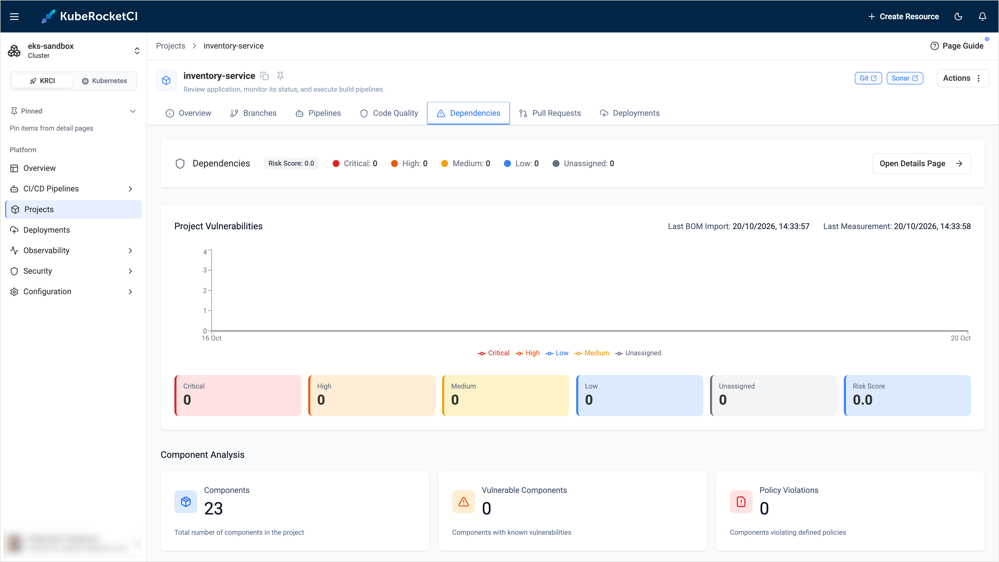

---

title: "Dependencies Tab Shows Zero Vulnerabilities"
description: "Troubleshooting guidance for the Dependencies tab of a project in the KubeRocketCI portal that shows components but zero vulnerabilities, including the OSS Index token decryption error in Dependency-Track."
sidebar_label: "Zero Vulnerabilities"

---
<!-- markdownlint-disable MD025 -->

# Dependencies Tab Shows Zero Vulnerabilities

<head>
  <link rel="canonical" href="https://docs.kuberocketci.io/docs/operator-guide/troubleshooting/dependency-track-zero-vulnerabilities" />
</head>

This troubleshooting page covers the missing vulnerabilities on the **Dependencies** tab of a project in the KubeRocketCI portal.

## Problem

The **Dependencies** tab shows components, but all vulnerability counters are `0` although the project uses vulnerable libraries:

  

## Cause

The SBOM is uploaded, but Dependency-Track has no working analyzer to match the components with known vulnerabilities. For example, the OSS Index analyzer is enabled but its API token cannot be decrypted, so the analyzer is skipped. The Dependency-Track log contains the following error:

```text
ERROR [OssIndexAnalysisTask] An error occurred decrypting the OSS Index API Token; Skipping
```

The message appears when the token was encrypted with a different key than the one the server uses now.

:::note
The vulnerability analysis runs asynchronously. Right after the upload, the counters can stay `0` for a few minutes.
:::

## Solution

1. Check the Dependency-Track log:

    ```bash
    kubectl -n <dependency-track-namespace> logs <api-server-pod> | grep OssIndexAnalysisTask
    ```

2. In Dependency-Track, open **Administration** -> **Analyzers**. Make sure that the **Internal** analyzer and at least one source of vulnerabilities are enabled. Changing these settings requires administrator permissions in Dependency-Track.

3. If the OSS Index analyzer logs the decryption error, enter the **Registered email address** and **API token** again and save the settings. Create the token in your Sonatype account on the [Sonatype Guide token page](https://guide.sonatype.com/settings/tokens).

4. Run the [security pipeline](../../user-guide/tekton-pipelines.md#security-test-and-release-pipeline) for the codebase again and open the **Dependencies** tab after a few minutes.

## Related Articles

* [KubeRocketCI Widgets](../../user-guide/widgets.md)
* [Integrate Dependency-Track](../devsecops/dependency-track.md)
