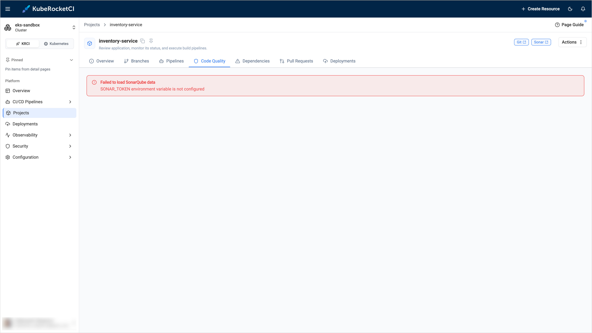

---

title: "Feature Is Not Configured"
description: "Troubleshooting guide for the KubeRocketCI portal messages 'environment variable is not configured', 'Metrics are not configured', and 'Configuration Error', with the table of portal environment variables that enable SonarQube, Dependency-Track, Tekton Results, Prometheus, GitFusion, and krci-audit."
sidebar_label: "Feature Is Not Configured"

---
<!-- markdownlint-disable MD025 -->

# Feature Is Not Configured

<head>
  <link rel="canonical" href="https://docs.kuberocketci.io/docs/operator-guide/troubleshooting/feature-not-configured" />
</head>

This troubleshooting page covers the portal pages that show an error because the portal has no address or credentials of an external service.

## Problem

A page of the KubeRocketCI portal shows one of the following messages instead of data:

  

  

  ")


| Where | Message |
|-------|---------|
| The **Code Quality** tab of a project | `Failed to load SonarQube data` with the description `SONAR_HOST_URL environment variable is not configured` or `SONAR_TOKEN environment variable is not configured` |
| The **Dependencies** tab of a project | `Failed to load DependencyTrack data` with the description `DEPENDENCY_TRACK_URL environment variable is not configured` or `DEPENDENCY_TRACK_API_KEY environment variable is not configured` |
| The **Pipeline Metrics** page | `Failed to load metrics` with the description `TEKTON_RESULTS_URL environment variable is not configured` |
| The **Monitoring** tab of a PipelineRun or a stage | `Metrics are not configured. Set PROMETHEUS_URL on the server.` |
| The whole portal, instead of any page | `Configuration Error` and `Failed to load server configuration. Please check your deployment environment variables.` |

Other pages use a common error block that hides the reason. It shows only a general message:

* `Something went wrong. Contact your administrator.`
* `The service is temporarily unavailable. Please try again later.`
* `Oops! Something went wrong. Please try again later.`

When the upstream service sends a request identifier, the block also shows `Request ID`. Use it to find the request in the log of the service.

## Cause

The portal reads the addresses of external services from environment variables of the portal Deployment. The non-sensitive values come from the `portal-config` ConfigMap, which Helm renders from the `krci-portal.configEnv` values. The tokens come from the `portal-secret` Secret. If a variable is missing or empty, the portal does not send the request and returns the `... is not configured` message.

The following table lists the variables and the features that depend on them:

| Variable | Stored in | Feature |
|----------|-----------|---------|
| `SONAR_HOST_URL`, `SONAR_TOKEN` | ConfigMap, Secret | Code Quality tab, SAST pages |
| `DEPENDENCY_TRACK_URL`, `DEPENDENCY_TRACK_API_KEY` | ConfigMap, Secret | Dependencies tab, SCA pages |
| `TEKTON_RESULTS_URL` | ConfigMap | Pipeline history, logs, and metrics |
| `PROMETHEUS_URL` | ConfigMap | **Monitoring** tab |
| `GITFUSION_URL` | ConfigMap | Repository and branch discovery through GitFusion |
| `KRCI_AUDIT_URL` | ConfigMap | **Triggered By** field and **Audit Events** page |

The `Configuration Error` screen has another meaning. The browser could not get the configuration from the portal server, so the server is unavailable, or the request failed. It does not mean that a specific variable is empty.

:::note
The default Helm values contain sample addresses, for example, `https://sonar.example.com/`. A sample address is not empty, so the portal sends the request to it and shows an error of the connection, not the `... is not configured` message. In this case, see [SonarQube Upstream Failure](sonarqube-upstream-failure.md) and [Dependency-Track Project Not Found](dependency-track-project-not-found.md).
:::

## Solution

1. Find the variable in the message. For the **Monitoring** tab, it is `PROMETHEUS_URL`.

2. For a variable from the ConfigMap, check its value:

    ```bash
    kubectl -n <krci-namespace> get configmap portal-config -o yaml | grep -E "SONAR_HOST_URL|DEPENDENCY_TRACK_URL|TEKTON_RESULTS_URL|PROMETHEUS_URL|GITFUSION_URL|KRCI_AUDIT_URL"
    ```

    If the value is empty or absent, set it in the Helm values and upgrade the release:

    ```yaml title="values.yaml"
    krci-portal:
      configEnv:
        PROMETHEUS_URL: http://prometheus.monitoring.svc:9090
    ```

    The portal Pod restarts by itself when the ConfigMap changes.

3. For a variable from the Secret (`SONAR_TOKEN`, `DEPENDENCY_TRACK_API_KEY`), check that the Secret contains the key. The command prints only the key names:

    ```bash
    kubectl -n <krci-namespace> get secret portal-secret -o jsonpath='{.data}' | jq 'keys'
    ```

    If the key is absent, add it:
    - If the `portal-secret` Secret is created manually, add the key to it, and restart the portal:

        ```bash
        kubectl -n <krci-namespace> rollout restart deploy/krci-portal
        ```

    - If the Secret is managed by the External Secrets Operator, add the key to the external store under the Portal `eso.secretPath`. The `ExternalSecret` resource copies all keys of that path, so the key name in the store must equal the variable name. To apply the value without waiting for the refresh interval, run:

        ```bash
        kubectl -n <krci-namespace> annotate externalsecret portal-secret force-sync=$(date +%s) --overwrite
        kubectl -n <krci-namespace> rollout restart deploy/krci-portal
        ```

        :::warning
        Do not delete the `ExternalSecret` resource. The Secret it creates is removed together with it, and the portal loses all its secret values, including the session secret. The portal Pod then cannot start after a restart.
        :::

    :::note
    By default, the portal stores sessions in a non-persistent database, so users sign in again after a restart. To avoid it, see [Portal Login and Session Issues](portal-login-issues.md).
    :::

4. If the **Configuration Error** screen appears, check that the portal Pod is running and read its log:

    ```bash
    kubectl -n <krci-namespace> get pods | grep krci-portal
    kubectl -n <krci-namespace> logs deploy/krci-portal --tail=100
    ```

## Related Articles

* [Upgrade KubeRocketCI v3.13](../upgrade/upgrade-krci-3.13.md)
* [Upgrade KubeRocketCI v3.14](../upgrade/upgrade-krci-3.14.md)
* [SonarQube Upstream Failure](sonarqube-upstream-failure.md)
* [Portal Login and Session Issues](portal-login-issues.md)
