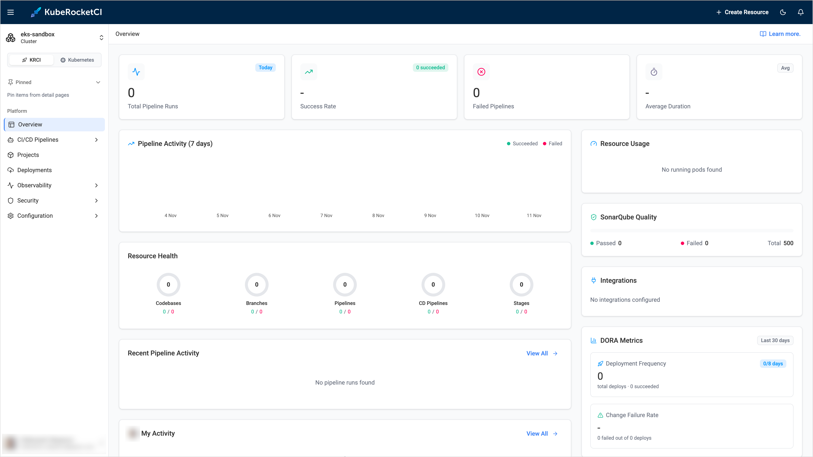

---

title: "Empty Widgets on the Overview Page"
description: "Troubleshooting guide for resolving empty widgets and forbidden messages on the KubeRocketCI portal overview page, detailing solutions for namespace settings, service account token, and Keycloak users."
sidebar_label: "Empty Widgets"

---
<!-- markdownlint-disable MD025 -->

# Empty Widgets on the Overview Page

<head>
  <link rel="canonical" href="https://docs.kuberocketci.io/docs/operator-guide/troubleshooting/forbidden-messages" />
</head>

## Problem

Users can't see resources within the KubeRocketCI dedicated namespace via KubeRocketCI portal. Depending on the cause, the pages are either empty, with all counters equal to zero, or the portal shows `Forbidden` messages. The following screenshot shows the empty **Overview** page:

  

## Cause

The problem might be caused by several factors. First of all, default and allowed namespaces may be either unset or set incorrectly. For example, if the default namespace points to a namespace that does not exist in the cluster, the portal does not report an error and shows empty pages. Secondly, service account used for browsing the KubeRocketCI portal may have insufficient permission set. Thirdly, if Keycloak is used for as an authentication mechanism, then the problem might be related to improper group membership.

## Solution

Solution can vary depending on the way users log into the platform, whether it is a service account token or an OpenID Connect mechanism.

### Solution 1 (Configure Default namespace)

This solution suits those who log into the KubeRocketCI portal via Keycloak.

To fix the problem, check both default and allowed namespaces. Click the cluster name in the upper left corner of the portal and select **Namespaces**, or click **Manage Namespaces** in the **Quick Actions** section of the **Home** page. Make sure that the KubeRocketCI namespace is set as the default one and is included in the allowed namespaces. To check that the namespace exists in the cluster, run `kubectl get namespace <namespace>`. Refer to the [KubeRocketCI portal](../../user-guide/portal-settings.md#manage-namespaces) page for more details.

:::note
The portal keeps the namespaces in the browser. If the namespaces were never set in this browser, the portal uses the `DEFAULT_CLUSTER_NAMESPACE` value from the portal configuration. For more details, see [How Does KubeRocketCI Determine the Default Namespace on First Login?](/faq/how-to/devops/determine-default-namespace-first-login)
:::

### Solution 2 (Service Account Token)

This solution suits those who use a service account token to log into the KubeRocketCI portal.

To fix the problem, follow the steps below:

1. Make sure the service account is set up in accordance with the [KubeRocketCI Access Model](../../operator-guide/auth/platform-auth-model.md#cluster-rbac-resources) and possesses the appropriate access rights.

2. Check the roles associated with the ServiceAccount:

    ```bash
    serviceaccount=<ServiceAccount_name>
    kubectl get rolebindings -n krci -o json | jq -r --arg sa "$serviceaccount" '.items[] | select(.subjects[]? | select(.kind == "ServiceAccount" and .name == $sa)) | .metadata.name'
    ```

3. Check permissions of the role used in the role binding:

    ```bash
    kubectl describe role <role-name> -n krci
    ```

4. Refresh the page and verify that the new RBAC settings are functioning properly.

## Related Articles

* [KubeRocketCI Access Model](../../operator-guide/auth/platform-auth-model.md)
