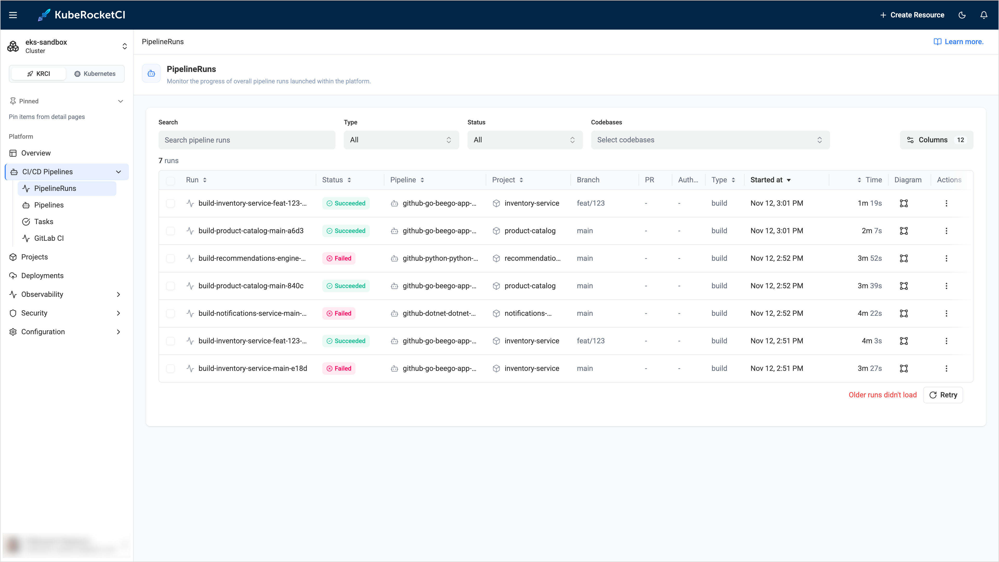

---

title: "PipelineRun History and Logs Are Missing"
description: "Troubleshooting guide for the KubeRocketCI portal that shows no older PipelineRuns, no logs of completed runs, or the 'Older runs didn't load' message because the Tekton Results API is unreachable, rejects the portal, or has not archived the runs."
sidebar_label: "PipelineRun History Is Missing"

---
<!-- markdownlint-disable MD025 -->

# PipelineRun History and Logs Are Missing

<head>
  <link rel="canonical" href="https://docs.kuberocketci.io/docs/operator-guide/troubleshooting/pipelinerun-history-missing" />
</head>

This troubleshooting page covers the problems with the history of PipelineRuns, the logs of completed runs, and the pipeline metrics in the KubeRocketCI portal.

## Problem

The portal shows only the PipelineRuns that still exist in the cluster, or it shows one of the following messages:

* Under the list of PipelineRuns, the portal shows `Older runs didn't load` and the **Retry** button:

  

* In the logs of a completed PipelineRun, the portal shows `Archiving in progress — logs will appear shortly...` and then, after one minute, `Logs may not be available` with the description `The pipeline has completed, but logs were not archived. Pod logs may have been garbage-collected.`
* The **Pipeline Metrics** page shows `Failed to load metrics`.
* The PipelineRun list shows no history for a namespace other than the default one.

## Cause

The portal keeps no history of its own. It shows the PipelineRuns that exist in the cluster, and it reads the completed runs, their logs, and the metrics from the Tekton Results API. The following table lists the causes and how they look in the portal log:

| Message in the portal log or error | Cause |
|------------------------------------|-------|
| `[Tekton Results] Status: 401` | The API requires a token, and the portal sent none or an invalid one. |
| `[Tekton Results] Status: 403` | The API accepted the token, but the portal ServiceAccount has no access to the Tekton Results of the namespace. |
| `[Tekton Results] Status: 400` and `Client sent an HTTP request to an HTTPS server` | The `TEKTON_RESULTS_URL` parameter starts with `http://`, but the API works over TLS. |
| `TEKTON_RESULTS_URL is not an https:// URL: the ServiceAccount token is not sent` | The portal sends its token only over HTTPS. |
| `No ServiceAccount token mounted: requests are sent unauthenticated` | The portal Pod has no ServiceAccount token because `serviceAccount.automount` is `false`. |
| `Tekton Results is unreachable` | The portal cannot connect to the API, for example, because of DNS, a network policy, or a certificate that the portal does not trust. |
| `TEKTON_RESULTS_URL environment variable is not configured` | The parameter is empty. See [Feature Is Not Configured](feature-not-configured.md). |

Other situations are not errors:

* **A run is not archived yet.** A PipelineRun is stored in Tekton Results shortly after it completes. If the Tekton Results watcher does not work or lags, the logs stay unavailable. If the Pod of the run is already deleted, the logs are lost.
* **History covers only the default namespace.** The portal reads Tekton Results of the default namespace only. If you filter the list by another namespace, only the live runs are shown.
* **An archived run cannot be selected.** The rows of the history have the `PipelineRun is archived` tooltip and are not selectable, because the run no longer exists in the cluster.

## Solution

1. Read the reason in the portal log:

    ```bash
    kubectl -n <krci-namespace> logs deploy/krci-portal | grep "Tekton Results"
    ```

2. Check the address and the portal values:

    ```bash
    kubectl -n <krci-namespace> get configmap portal-config -o yaml | grep TEKTON_RESULTS_URL
    ```

    Since KubeRocketCI 3.16.1, the Tekton Results API works over `https://` with authentication. The portal needs the `https://` address, the CA certificate of the API, and the read access of its ServiceAccount. Set the values as described in [Configure the Portal for the Tekton Results API](../ci/tekton-long-term-storage.md#configure-the-portal-for-the-tekton-results-api):

    ```yaml title="values.yaml"
    krci-portal:
      configEnv:
        TEKTON_RESULTS_URL: https://tekton-results-api-service.tekton-pipelines.svc:8080
      tektonResults:
        rbac:
          enabled: true
        caCert: |
          -----BEGIN CERTIFICATE-----
          <contents of ca.crt>
          -----END CERTIFICATE-----
    ```

    :::note
    If you did not enable the authentication and TLS for Tekton Results, the API still works over plain HTTP without a token. In this case, the `http://` address is correct, the portal shows the history, and the warning about the missing `https://` address in the log is harmless.
    :::

    To check which mode the API uses, send a request from the portal Pod. The command sends no token:

    ```bash
    kubectl -n <krci-namespace> exec deploy/krci-portal -- node -e '
    fetch(process.env.TEKTON_RESULTS_URL + "/apis/results.tekton.dev/v1alpha2/parents/<namespace>/results?page_size=10", { signal: AbortSignal.timeout(10000) })
      .then(async r => console.log(r.status, (await r.text()).slice(0, 200)))
      .catch(e => console.log("ERROR:", e.cause?.code || e.message))
    '
    ```

    The `200` status means that the API needs no token. The `401` or `403` status means that the API requires authentication, so the portal needs the `https://` address and the values above. The `400` status with the `Client sent an HTTP request to an HTTPS server` message means that the API works over TLS, so use the `https://` address.

3. If the API is unreachable, check that the Tekton Results Pods are running, and that the address from step 2 resolves from the portal namespace:

    ```bash
    kubectl -n tekton-pipelines get pods | grep tekton-results
    kubectl -n tekton-pipelines get svc tekton-results-api-service
    ```

4. If the logs of new runs never appear, check that the watcher archives them. Read the log of the watcher Pod from the output of the previous step, for example:

    ```bash
    kubectl -n tekton-pipelines logs <tekton-results-watcher-pod> --tail=100
    ```

5. After you change a Helm value, the portal Pod restarts by itself. Open the **PipelineRuns** page again, or click **Retry** under the list.

## Related Articles

* [Tekton Long-Term Log Storage](../ci/tekton-long-term-storage.md)
* [Feature Is Not Configured](feature-not-configured.md)
* [Empty Widgets on the Overview Page](forbidden-messages.md)
