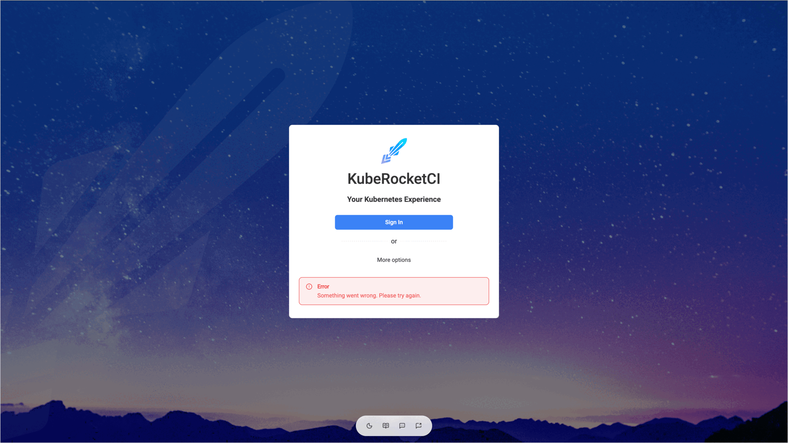
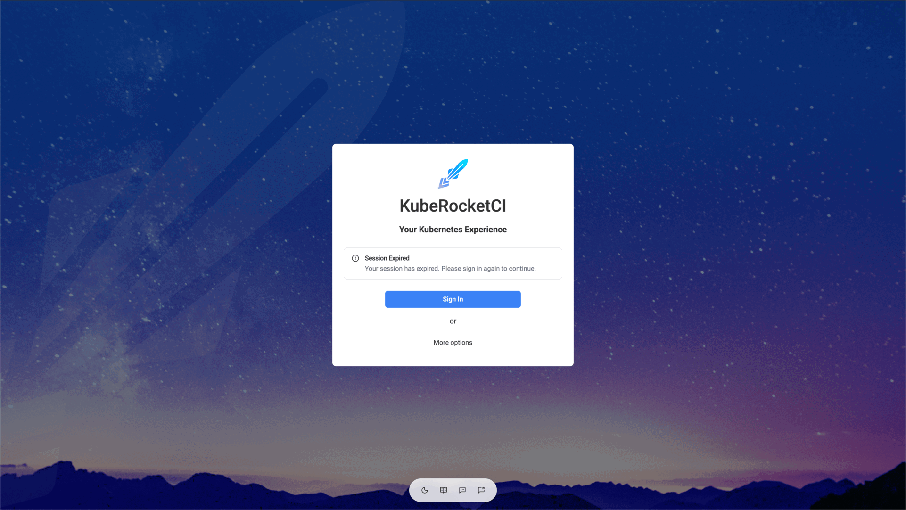

---

title: "Portal Login and Session Issues"
description: "Troubleshooting guide for the KubeRocketCI portal login errors, sign-in loops, expired sessions, and Service Account token login failures, including OIDC client, HTTPS, and session persistence settings."
sidebar_label: "Login and Session Issues"

---
<!-- markdownlint-disable MD025 -->

# Portal Login and Session Issues

<head>
  <link rel="canonical" href="https://docs.kuberocketci.io/docs/operator-guide/troubleshooting/portal-login-issues" />
</head>

This troubleshooting page covers the problems that occur when users sign in to the KubeRocketCI portal or when the portal ends their session.

## Problem

The sign-in fails in one of the following ways:

* After you click **Sign In** and authenticate in Keycloak, the portal returns you to the login page and shows the red **Error** message `Something went wrong. Please try again.`:

  

* The login page shows the **Session Expired** message `Your session has expired. Please sign in again to continue.`, or the portal shows the `Session expired. Please log in again.` notification:

  

* After the sign-in, the portal opens the login page again and again.

* All users are signed out after the portal is updated or restarted.

* The **Use Service Account Token** form rejects a token.

## Cause

The portal shows the same generic message for most of the sign-in failures, so the real reason is visible only in the portal log. The following table lists the messages that the portal writes there and what they mean:

| Message in the portal log or token form | Cause |
|-----------------------------------------|-------|
| `Invalid callback URL origin` | The address in the browser differs from the `PORTAL_URL` parameter of the portal. |
| `No pending login session` | The browser did not send the session cookie back after the redirect from Keycloak. The portal sets the cookie with the `Secure` and `SameSite=Strict` attributes, so the browser does not keep it when you open the portal over plain HTTP. The cookie is also lost when the portal pod restarts between the redirect to Keycloak and the return. |
| `Invalid or mismatched state parameter` | The sign-in was started in another browser tab or session, or the cookie was replaced during the sign-in. |
| `Failed to connect to the identity provider.` | The portal pod cannot reach the `OIDC_ISSUER_URL` address, for example, because of DNS, a network policy, or a TLS certificate that is not trusted. |
| `Server could not initialize OIDC client.` | At least one of the `OIDC_ISSUER_URL`, `OIDC_CLIENT_ID`, `OIDC_SCOPE`, `OIDC_CODE_CHALLENGE_METHOD` parameters or the `OIDC_CLIENT_SECRET` secret value is empty. |
| `Your account does not have an email address, which is required to sign in.` | The Keycloak user has no email address. |
| `Sign-in failed: the identity provider did not return the required profile information` | The `OIDC_SCOPE` parameter lacks the `profile` or `email` scope, or the Keycloak client does not add the claims to the token. |

A session also ends by itself:

* The session cookie lives for 24 hours. After that, you sign in again.
* The portal stores sessions in a local SQLite database. By default, the database is not persistent, so every restart of the portal pod, for example, after an upgrade, deletes all sessions.
* A session started with a token has no refresh token, so it ends when the token expires. A Service Account token created with `kubectl create token` lives for one hour by default. A session lasts no longer than 24 hours, even if the token is valid longer.
* The identity provider can refuse to refresh the session, for example, when the user's session in Keycloak is closed.

## Solution

1. Read the reason in the portal log:

    ```bash
    kubectl logs -n <krci-namespace> deploy/krci-portal | grep -i "oidc\|session\|login"
    ```

2. Make sure the portal opens over HTTPS, and the address in the browser matches the `PORTAL_URL` parameter exactly, including the scheme and the host name, without a trailing path. Set the parameter in the Helm values:

    ```yaml title="values.yaml"
    krci-portal:
      configEnv:
        PORTAL_URL: https://portal.example.com
    ```

3. In Keycloak, open the portal client and check that **Valid redirect URIs** contains the portal address with the wildcard, for example, `https://portal.example.com/*`. The portal sends the user back to the `/auth/callback` path. For more details, see [Portal OIDC Configuration](../auth/ui-portal-oidc.md).

4. Check that the `portal-secret` Secret contains the `OIDC_CLIENT_SECRET` and `SERVER_SECRET` keys, and that the `extraEnvFrom` parameter references both the secret and the `portal-config` ConfigMap:

    ```bash
    kubectl -n <krci-namespace> get secret portal-secret -o jsonpath='{.data}' | jq 'keys'
    ```

5. Check that the Keycloak user has an email address, and that the client delivers the `profile` and `email` scopes. The portal requests the scopes from the `OIDC_SCOPE` parameter, which is `openid profile email` by default.

6. To keep users signed in after the portal restarts, enable the persistent storage for the session database:

    ```yaml title="values.yaml"
    krci-portal:
      persistence:
        enabled: true
    ```

    :::note
    The persistent volume forces the portal Deployment to use the `Recreate` update strategy, so the portal is unavailable for a short time during an update.
    :::

7. If the **Use Service Account Token** form shows an error, find it in the table:

    | Message | Solution |
    |---------|----------|
    | `The service account token was rejected by the cluster. Verify the token is valid and not expired.` | Create a new token: `kubectl create token <service-account> -n <namespace> --duration=24h`. |
    | `The cluster does not support SelfSubjectReview. This requires Kubernetes 1.28+ (GA) or 1.26+ (beta).` | The portal validates the token with the SelfSubjectReview API. Update the cluster, or use the Keycloak sign-in. |
    | `Failed to validate the service account token against the cluster.` | The portal cannot reach the Kubernetes API. Check the portal log and the network connection. |

## Related Articles

* [Portal OIDC Configuration](../auth/ui-portal-oidc.md)
* [Empty Widgets on the Overview Page](forbidden-messages.md)
