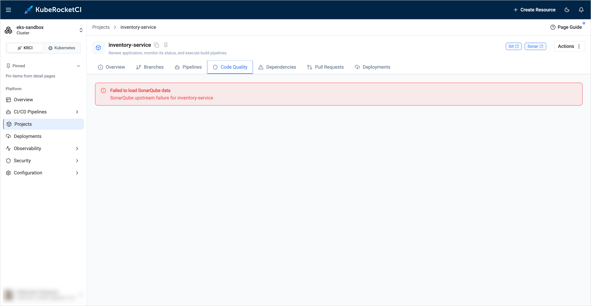

---

title: "SonarQube Upstream Failure"
description: "Troubleshooting guidance for the Code Quality tab of a project in the KubeRocketCI portal that shows the SonarQube upstream failure error, including invalid tokens and connection problems."
sidebar_label: "SonarQube Upstream Failure"

---
<!-- markdownlint-disable MD025 -->

# SonarQube Upstream Failure

<head>
  <link rel="canonical" href="https://docs.kuberocketci.io/docs/operator-guide/troubleshooting/sonarqube-upstream-failure" />
</head>

This troubleshooting page covers the error on the **Code Quality** tab of a project in the KubeRocketCI portal.

## Problem

The **Code Quality** tab shows `Failed to load SonarQube data` and `SonarQube upstream failure for <codebase>`:

  

## Cause

The portal reads SonarQube with its own credentials, separate from the `ci-sonarqube` secret that pipelines use. The portal sent a request to SonarQube and did not get a valid answer. Typical reasons are:

| Reason | Description |
|--------|-------------|
| Invalid or expired token | The `SONAR_TOKEN` of the portal is wrong, expired, or revoked. SonarQube answers with the `401` status. |
| Insufficient permissions | The token user lacks the `Browse` and `View Issues` permissions on the project. SonarQube answers with the `403` status. |
| Wrong URL or network problem | The `SONAR_HOST_URL` is wrong, or a TLS, DNS, or network policy problem blocks the connection. |

:::note
If SonarQube is reachable but has no project with the codebase name as a key, the tab shows `project <codebase> not found` instead. In this case, run a build pipeline for the codebase.
:::

## Solution

1. Find the real reason in the portal log:

    ```bash
    kubectl logs -n <krci-namespace> deploy/krci-portal | grep "\[SonarQube\]"
    ```

2. Send the same request from the portal pod. The portal image has no `curl`, so use `node`:

    ```bash
    kubectl -n <krci-namespace> exec deploy/krci-portal -- node -e '
    const base = (process.env.SONAR_HOST_URL || "").replace(/\/+$/, "");
    console.log("SONAR_HOST_URL:", base || "(empty)", "| token set:", !!process.env.SONAR_TOKEN);
    fetch(base + "/api/components/show?component=<codebase>", {
      headers: { Authorization: "Basic " + Buffer.from(process.env.SONAR_TOKEN + ":").toString("base64") },
      signal: AbortSignal.timeout(10000),
    }).then(async r => console.log(r.status, (await r.text()).slice(0, 300)))
      .catch(e => console.log("ERROR:", e.cause?.code || e.message));
    '
    ```

    The command prints the portal URL, whether a token is set, and the answer of SonarQube. Use the HTTP status to find the cause:

    | Status | Meaning |
    |--------|---------|
    | `200` | SonarQube and the token are fine. Check the portal log for another reason. |
    | `401` | The token is invalid or expired. Generate a new token and replace it. |
    | `403` | The token user lacks the `Browse` or `View Issues` permission on the project. |
    | `404` | SonarQube has no project with this key. |
    | Network error | Check the URL, DNS, TLS, and network policies between the portal and SonarQube. |

3. Replace the token. Generate a new one as described in [Configuration SonarQube ci-user](../code-quality/sonarqube.md#configuration-sonarqube-ci-user-without-sonar-operator), and update `SONAR_TOKEN`:
    - If the `portal-secret` Secret is created manually, update the `SONAR_TOKEN` key in it.
    - If the Secret is managed by the External Secrets Operator, update the value in the external store under the Portal `eso.secretPath`. The Operator overwrites manual changes of the Secret. To apply the new value without waiting for the refresh interval, run:

        ```bash
        kubectl -n <krci-namespace> annotate externalsecret portal-secret force-sync=$(date +%s) --overwrite
        ```

        :::warning
        Do not delete the `ExternalSecret` resource. The Secret it creates is removed together with it, and the portal loses all its secret values.
        :::

4. Restart the portal to apply the new token and open the tab again:

    ```bash
    kubectl -n <krci-namespace> rollout restart deploy/krci-portal
    ```

## Related Articles

* [KubeRocketCI Widgets](../../user-guide/widgets.md)
* [SonarQube Integration](../code-quality/sonarqube.md)
