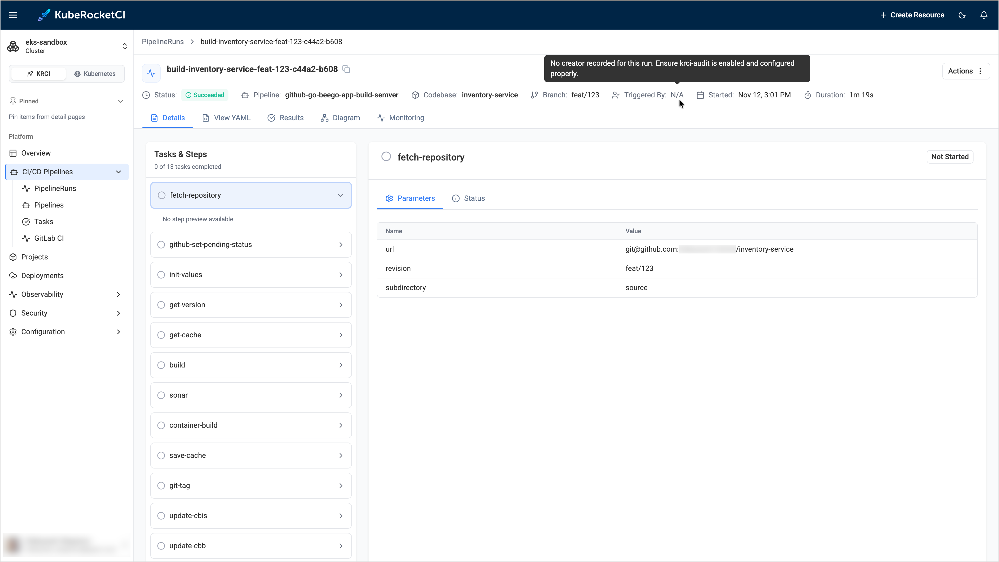
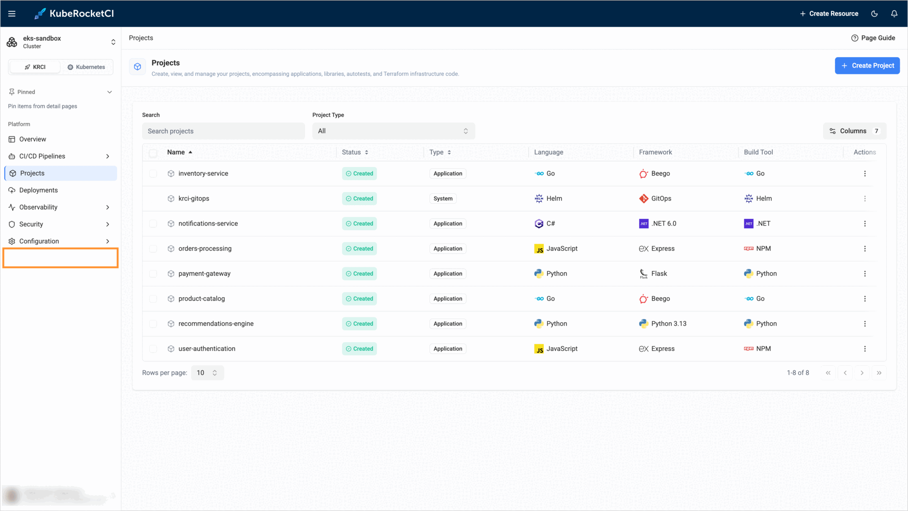
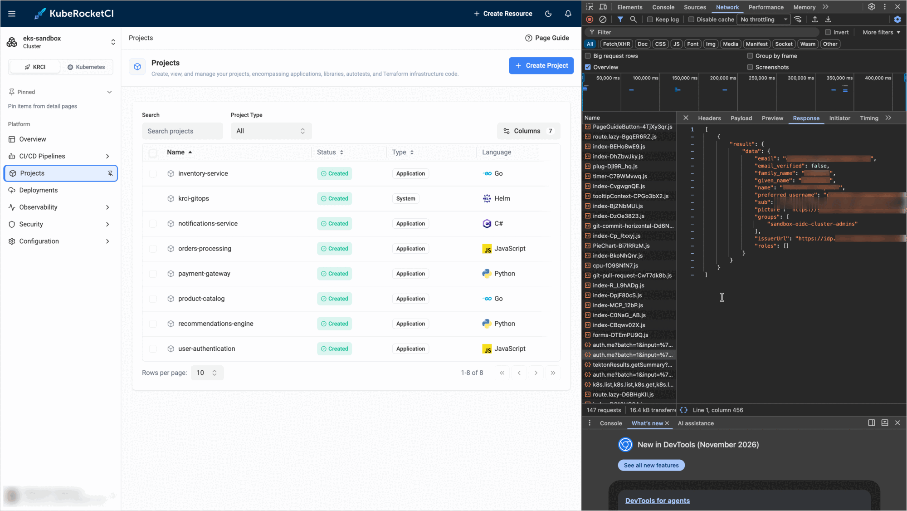
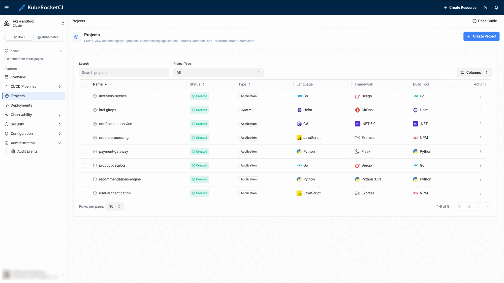

---

title: "Triggered By Is N/A or Administration Is Missing"
description: "Troubleshooting guide for the KubeRocketCI portal that shows Triggered By N/A on a PipelineRun, no Administration section in the sidebar, or an empty My Activity card, including krci-audit, administrator group, and Git author settings."
sidebar_label: "Triggered By and Administration"

---
<!-- markdownlint-disable MD025 -->

# Triggered By Is N/A or Administration Is Missing

<head>
  <link rel="canonical" href="https://docs.kuberocketci.io/docs/operator-guide/troubleshooting/triggered-by-and-administration" />
</head>

This troubleshooting page covers three questions about the identity of users in the KubeRocketCI portal: why a PipelineRun has no initiator, why the **Administration** section is not in the sidebar, and why the **My Activity** card is empty.

## Problem

The portal shows one of the following:

* The header of a PipelineRun shows `Triggered By: N/A`. The tooltip of the value says `No creator recorded for this run. Ensure krci-audit is enabled and configured properly.`:

  

* The sidebar has no **Administration** section, so the **Audit Events** page is not available:

  

* The **My Activity** card on the **Overview** page shows `No pipeline runs found for your account`.

## Cause

Each of the three items has its own cause:

| Item | Cause |
|------|-------|
| `Triggered By: N/A` | The portal reads the creator of a run from the **krci-audit** add-on. The value is `N/A` when the add-on is not installed, the `KRCI_AUDIT_URL` parameter is empty or wrong, the add-on is not reachable, or it has no creation record for the run. |
| No **Administration** section | The portal shows the section only to users with the `administrator` role. The role comes from the OIDC groups of the user: the user must belong to the `administrator` group in Keycloak, or to a group listed in the `PORTAL_ADMIN_GROUPS` parameter. A session that uses a Service Account token never gets the role. |
| Empty **My Activity** | The card does not use `Triggered By`. It compares the Git author of the runs with your name, your email, or the part of your email before `@`. It lists only the five latest runs that exist in the cluster now, so older archived runs are not included. |

## Solution

### Triggered By Is N/A

1. Check the address of the add-on and that its Pods are running:

    ```bash
    kubectl -n <krci-namespace> get configmap portal-config -o yaml | grep KRCI_AUDIT_URL
    kubectl get pods -A | grep krci-audit
    ```

    The default address is `http://krci-audit-api.krci-audit:8080`. If the add-on is installed in another namespace, set its address:

    ```yaml title="values.yaml"
    krci-portal:
      configEnv:
        KRCI_AUDIT_URL: http://krci-audit-api.krci-audit:8080
    ```

2. If the add-on is not installed, install it as described in [Audit Trails Setup](../monitoring-and-observability/audit-trails-setup.md). The add-on records only the runs created after its installation, so the older runs keep the `N/A` value.

### Administration Is Missing

1. Sign in with OIDC. The Service Account token login never shows the section.

2. Check which groups the portal received. In the browser, open the developer tools, switch to the **Network** tab, reload the portal page, and open the response of the `auth.me` request. The `groups` field lists the groups from the token, and the `roles` field lists the portal roles. The section is shown only when `roles` contains `administrator`. Do not share this response, because it also contains your name and email. The membership in a group that gives access to the cluster, for example, a `cluster-admins` group, does not give the portal role. Only the `administrator` group or the groups from the `PORTAL_ADMIN_GROUPS` parameter do:

    

3. In Keycloak, add the user to the `administrator` group. If your administrators use another group, set its name in the Helm values. To list several groups, separate them with commas:

    ```yaml title="values.yaml"
    krci-portal:
      configEnv:
        PORTAL_ADMIN_GROUPS: administrator,platform-admins
    ```

    The portal Pod restarts by itself when the ConfigMap changes.

4. Sign out and sign in again, so that the portal reads the groups of the user again. After that, the **Administration** section with the **Audit Events** page appears in the sidebar:

    

### My Activity Is Empty

1. Check the name and the email in the Git commits of your runs. They must match your name or email in the portal. The match ignores the letter case.
2. Remember that the card shows only the runs that still exist in the cluster. To see the older runs, open the **PipelineRuns** page.

## Related Articles

* [Audit Trails Setup](../monitoring-and-observability/audit-trails-setup.md)
* [Portal Login and Session Issues](portal-login-issues.md)
* [Feature Is Not Configured](feature-not-configured.md)
