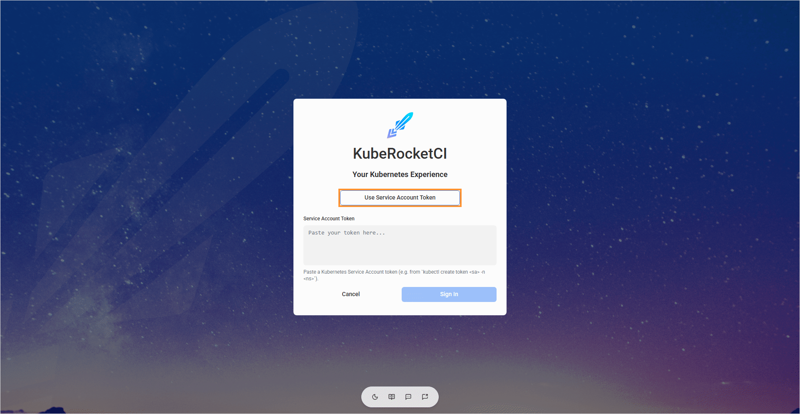
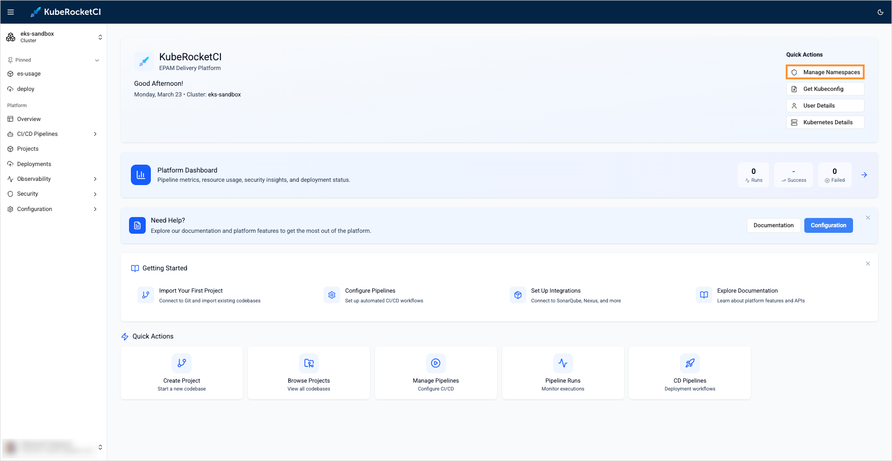
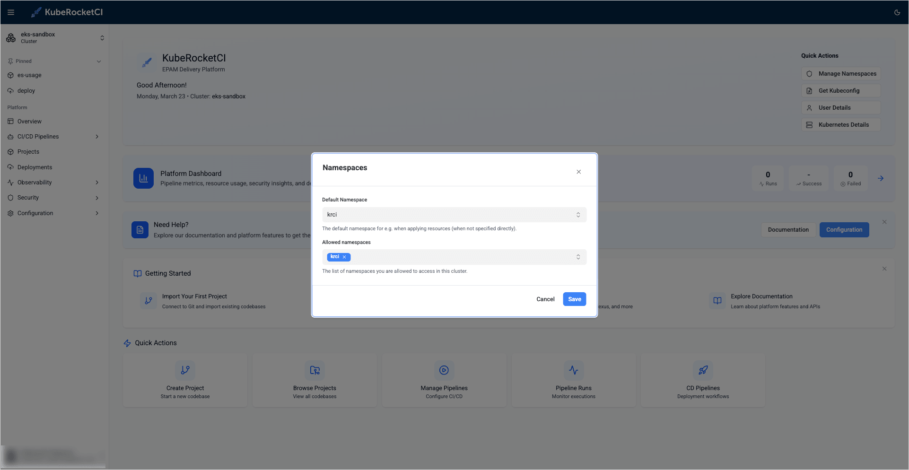

<!-- markdownlint-disable MD025 -->
<head>
  <link rel="canonical" href="https://docs.kuberocketci.io/docs/quick-start/platform-installation" />
</head>

# Install KubeRocketCI

To install KubeRocketCI, deploy the prerequisites (Tekton, cert-manager, and the NGINX Ingress Controller) and then install the platform itself with Helm on any Kubernetes cluster. This quick start walks through these steps and ends with your first login to the KubeRocketCI Portal — no prior platform experience required.

<div style={{ display: 'flex', justifyContent: 'center' }}>
<iframe width="560" height="315" src="https://www.youtube-nocookie.com/embed/ILlY4niCWeU" title="YouTube video player" frameborder="0" allow="accelerometer; autoplay; clipboard-write; encrypted-media; gyroscope; picture-in-picture" allowfullscreen="allowfullscreen"></iframe>
</div>

## Install Tekton

KubeRocketCI relies on Tekton resources, including Tasks, Pipelines, Triggers, and Interceptors to execute CI/CD pipelines.

To install Tekton, run the commands below:

  ```bash
  kubectl apply -f https://infra.tekton.dev/tekton-releases/pipeline/previous/v1.6.2/release.yaml
  kubectl apply -f https://infra.tekton.dev/tekton-releases/triggers/previous/v0.36.0/release.yaml
  kubectl apply -f https://infra.tekton.dev/tekton-releases/triggers/previous/v0.36.0/interceptors.yaml
  ```

## Install cert-manager

The KubeRocketCI operators rely on [cert-manager](https://cert-manager.io/) to issue the TLS certificates for their admission webhooks.

To install cert-manager, run the command below:

  ```bash
  kubectl apply -f https://github.com/cert-manager/cert-manager/releases/download/v1.21.2/cert-manager.yaml
  ```

## Install NGINX Ingress Controller

The KubeRocketCI Portal sends its session cookie over HTTPS only. The NGINX Ingress Controller provides the HTTPS endpoint for opening the Portal.

To install the NGINX Ingress Controller, run the command below:

  ```bash
  kubectl apply -f https://raw.githubusercontent.com/kubernetes/ingress-nginx/controller-v1.15.1/deploy/static/provider/cloud/deploy.yaml
  ```

## Install platform

To deploy the platform, follow the steps below:

1. Wait until the prerequisites are ready:

    ```bash
    kubectl wait deployment --all --for=condition=Available --timeout=300s -n tekton-pipelines
    kubectl wait deployment --all --for=condition=Available --timeout=300s -n cert-manager
    kubectl wait pod --selector=app.kubernetes.io/component=controller --for=condition=Ready --timeout=300s -n ingress-nginx
    ```

2. Add a Helm Chart repository:

    ```bash
    helm repo add epamedp https://epam.github.io/edp-helm-charts/stable
    helm repo update
    ```

3. Create the `krci` namespace and the `portal-secret` secret. The Portal reads this secret by default, uses its `SERVER_SECRET` key to protect user sessions, and does not start without it:

    ```bash
    kubectl create namespace krci
    kubectl create secret generic portal-secret -n krci --from-literal=SERVER_SECRET="$(openssl rand -base64 32)"
    ```

4. Create the `values.yaml` file with the following content. The platform chart creates no Ingress by default, so the file enables the Portal Ingress for the NGINX Ingress Controller installed above:

    ```yaml title="values.yaml"
    global:
      # Wildcard DNS name that resolves to the local machine
      dnsWildCard: 127.0.0.1.nip.io

    krci-portal:
      ingress:
        # Its host is krci-portal-<namespace>.<dnsWildCard>: krci-portal-krci.127.0.0.1.nip.io
        enabled: true
        className: nginx
      configEnv:
        # No identity provider is used in this guide,
        # so the Portal offers only the service account token login
        OIDC_ISSUER_URL: ""
    ```

5. Deploy the platform using the `helm install` command:

    ```bash
    helm install krci epamedp/edp-install --version 3.16.0 --wait -n krci --values values.yaml
    ```

6. Upon successful deployment of the KubeRocketCI Helm Chart, run the `kubectl port-forward` command to reach the ingress controller:

    ```bash
    kubectl port-forward service/ingress-nginx-controller 8443:443 -n ingress-nginx
    ```

7. Open the Portal in your browser to access the login menu and click **Use Service Account Token**:

    ```bash
    https://krci-portal-krci.127.0.0.1.nip.io:8443
    ```

    :::note
      The ingress controller serves a self-signed certificate, so the browser shows a security warning. Accept it to proceed to the Portal.
    :::

    

8. Create the edp-admin service account and generate its token to open the KubeRocketCI:

    ```bash
    kubectl -n krci create serviceaccount edp-admin
    kubectl create clusterrolebinding edp-admin --serviceaccount=krci:edp-admin --clusterrole=cluster-admin
    kubectl create token edp-admin -n krci
    ```

9. In the login menu, paste the generated token in the **Service Account Token** field and click the **Sign In** button.

10. Upon logging in, open the namespaces window by clicking the **Manage Namespaces** button in the top right corner of the page:

    

11. Ensure the `krci` namespace is specified in both default and allowed namespaces. If not, define them manually:

    * Default namespace: `krci`
    * Allowed namespaces: `krci`

    

    :::note
      Remember to press **Enter** to add the allowed namespace to the list.
    :::

After completing these steps, you will gain access to KubeRocketCI components through the KubeRocketCI portal. You can now proceed with the integration steps, starting with the [SonarQube](./integrate-sonarcloud.md) integration.
