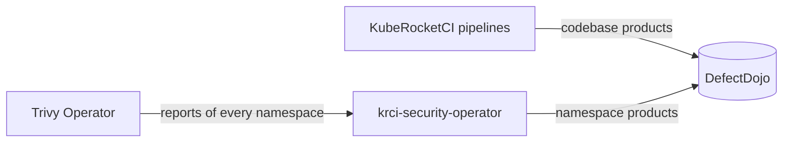

<!-- markdownlint-disable MD025 -->

# Runtime Security Findings in DefectDojo

<head>
  <link rel="canonical" href="https://docs.kuberocketci.io/docs/operator-guide/devsecops/runtime-security-findings" />
</head>

:::info
  This page applies to krci-security-operator 0.2.0 and later. Earlier versions use a different product layout and are not described here.
:::

KubeRocketCI pipelines scan source code and container images before deployment. The [KubeRocketCI Security Operator](https://github.com/KubeRocketCI/krci-security-operator) (`krci-security-operator`) adds the runtime view: it imports the [Trivy Operator](https://aquasecurity.github.io/trivy-operator/) reports of every namespace of a cluster into DefectDojo, so each finding shows the cluster, namespace, workload, container, and image where it runs.

This page describes how the operator organizes runtime findings in DefectDojo next to the findings of the CI pipelines, how to filter them, and when the operator closes them. It is written for platform operators who connect one or several clusters to one DefectDojo.



The operator reads only Kubernetes and Trivy Operator objects: namespaces, workloads, reports, and its credentials Secret. It reads no KubeRocketCI resources or labels, so it works the same on a cluster without KubeRocketCI. In the cluster it only reads, apart from its leader-election Lease and its events; it writes findings only to DefectDojo.

## Prerequisites

- The `krci-security-operator` chart version 0.2.0 or later.
- Trivy Operator 0.34.0 or later is installed in the cluster and produces `VulnerabilityReport` and `ExposedSecretReport` objects.
- DefectDojo is reachable from the operator pod.
- DefectDojo 3.5.200 or later. Earlier versions may work but are not tested.
- A DefectDojo API token of a user for the operator. See [DefectDojo API Token](#defectdojo-api-token).
- A cluster name that is unique in this DefectDojo. See [Cluster Name](#cluster-name).

## Full View: CI and Runtime Products

:::note
  This page uses the DefectDojo API names Product Type and product, as in the API paths and filters. By default, the DefectDojo UI shows Product Types as **Organizations** and products as **Assets**.
:::

Both producers write into one Product Type, `KubeRocketCI` by default:

- The CI pipelines write **codebase products**, one per KubeRocketCI codebase. See [Security Scanning Pipelines](./security-pipelines.md#defectdojo-reporting-model).
- The operator writes **namespace products**, one per cluster and namespace.

Each producer writes only its own products. A codebase name has no `/`, and a namespace product name always has one, so the names never clash. The operator never reads or writes codebase products.

The example below shows one codebase, `checkout`, deployed to the `krci-shop-dev` namespace of the `in-cluster` cluster and to the `krci-shop-prod` namespace of the `prod-eu` cluster. The `payments` namespace of `prod-eu` is not managed by KubeRocketCI, and the operator imports it as well.

```text
Product Type: KubeRocketCI
├─ Product: checkout                                       ← CI pipeline
│   ├─ Engagement: code-security-main
│   │   ├─ Test: Semgrep JSON Report
│   │   └─ Test: Gitleaks Scan
│   └─ Engagement: image:registry.example.com/shop/checkout
│       ├─ Test: Trivy Scan                                  version 2.4.1
│       └─ Test: Anchore Grype                               version 2.4.1
│
├─ Product: in-cluster/krci-shop-dev                       ← krci-security-operator
│   └─ Engagement: trivy-operator
│       └─ Test: VulnerabilityReport deployment/checkout/checkout    version 2.5.0-rc1
│             tags: k8s-cluster:in-cluster  k8s-namespace:krci-shop-dev
│                   k8s-workload:deployment.checkout  k8s-container:checkout
│                   oci-image:registry.example.com/shop/checkout  app:checkout
│
├─ Product: prod-eu/krci-shop-prod                         ← krci-security-operator
│   └─ Engagement: trivy-operator
│       └─ Test: VulnerabilityReport deployment/checkout/checkout    version 2.4.1
│
└─ Product: prod-eu/payments                               ← krci-security-operator
    └─ Engagement: trivy-operator
        ├─ Test: VulnerabilityReport deployment/api/api              version 1.8.0
        ├─ Test: VulnerabilityReport deployment/api/istio-proxy      version 1.24.0
        ├─ Test: VulnerabilityReport statefulset/redis/redis         version 7.4
        ├─ Test: VulnerabilityReport cronjob/cleanup/cleanup         version sha256:9155b03ee4d9
        └─ Test: ExposedSecretReport deployment/api/api              version 1.8.0
```

| | Codebase product (CI) | Namespace product (runtime) |
|---|---|---|
| Product name | `<codebase>` | `<cluster name>/<namespace>` |
| Engagements | `code-security-<branch>`, `image:<registry>/<repository>` | `trivy-operator` |
| Tests | One per scanner: `Semgrep JSON Report`, `Gitleaks Scan`, `Trivy Scan`, `Anchore Grype` | One per report kind, stable workload, and container |
| Scan type of image tests | `Trivy Scan`, `Anchore Grype` | `Trivy Operator Scan` |
| Answers | Which vulnerabilities does the built image have? | Which vulnerabilities run in this namespace now? |

## Namespace Product Layout

Every report of every namespace goes to the namespace product of its cluster:

| Level | Name |
|---|---|
| Product Type | The `defectdojo.productType` chart value. Default: `KubeRocketCI` |
| Product | `<cluster name>/<namespace>` |
| Engagement | `trivy-operator`, with deduplication on the engagement |
| Test | `<ReportKind> <kind>/<name>/<container>`, where `<ReportKind>` is `VulnerabilityReport` or `ExposedSecretReport` |

The test title names the **stable workload**: the workload that keeps its name across rollouts. A rollout therefore updates the same test instead of creating a new one:

| Trivy Operator reports on | Stable workload in the test title |
|---|---|
| A ReplicaSet owned by a Deployment | `deployment/<name>` |
| A Job owned by a CronJob | `cronjob/<name>` |
| A StatefulSet, DaemonSet, standalone ReplicaSet, standalone Job, or Pod | The object itself: `statefulset/<name>`, `daemonset/<name>`, `replicaset/<name>`, `job/<name>`, `pod/<name>` |

Each container of the pod template has its own test, init containers included, and for a Pod also its ephemeral containers. The test title has no namespace, because the product already names it.

Each test stores:

- **Version**: the image tag, or `sha256:` and the first 12 characters of the digest when the image has no tag.
- **Service** of every finding: `<namespace>/<Kind>/<name>/<container>`, for example `payments/Deployment/api/api`.

The operator imports only the **current report** of a workload: the report of the live Deployment revision, of the newest Job of a CronJob, and only for a container that is still in the pod template. Reports of older ReplicaSets and removed containers are history and are not imported. Products, engagements, and tests are created on first use.

## Cluster Name

The cluster name is mandatory. The chart does not render without the `clusterName` value, and the operator does not start without it. The value must be a lowercase RFC 1123 DNS label, for example `prod-eu`.

The cluster name must be unique per DefectDojo:

- The same namespace name in two clusters gives two products, `in-cluster/payments` and `prod-eu/payments`, because the cluster name is part of the product name.
- The operator closes only the tests it owns: tests of a product whose name starts with `<cluster name>/` and whose scan type is `Trivy Operator Scan`. So it never closes the tests of another cluster or of a codebase product.
- Two clusters with the same name write into, and close, the same products. Their findings mix, and each operator closes the findings of the workloads that run only in the other cluster.

:::warning
  Choose the cluster name before the first installation and do not reuse it for another cluster. The name is part of every product name, so a renamed cluster writes into new products, and the products under the old name are no longer closed.
:::

## Product Type

The Product Type is a setting, `defectdojo.productType`, with the default `KubeRocketCI`. The CI tasks take it from the `DD_PRODUCT_TYPE_NAME` task parameter with the same default. The pipelines of the `pipelines-library` chart do not pass this parameter, so the codebase products are always under `KubeRocketCI`.

- Use one value for every operator that writes to the same DefectDojo, so that all namespace products are in one group. Keep the default `KubeRocketCI` to have the namespace products next to the codebase products.
- A reimport fails when the product already exists under another Product Type. If you change the value later, the existing namespace products stay under the old Product Type, and their reimports fail until you move the products.

## Tags

The operator writes tags in the `<key>:<value>` form. Each value is lowercase; spaces, commas, `'`, and `"` become `-`. A value that would make a tag longer than 255 characters is shortened: its start, `~`, and the first 12 hex characters of its SHA-256 hash.

**Product tags**: every namespace product carries two tags. The operator adds or corrects them on every pass over the namespace and keeps the other tags of the product:

| Tag | Value |
|---|---|
| `k8s-cluster` | `<cluster name>` |
| `k8s-namespace` | `<namespace>` |

**Test tags**: every reimport sends the full tag list of the test, and DefectDojo replaces the tags of the test with it:

| Tag | Value | Example |
|---|---|---|
| `k8s-cluster` | `<cluster name>` | `k8s-cluster:prod-eu` |
| `k8s-namespace` | `<namespace>` | `k8s-namespace:payments` |
| `k8s-workload` | `<kind>.<name>` of the stable workload, kind in lowercase | `k8s-workload:deployment.api` |
| `k8s-container` | `<container>` | `k8s-container:istio-proxy` |
| `oci-image` | `<registry>/<repository>` of the image, without tag and digest. Docker Hub images have no host and no `library/` prefix. Omitted when the report names no image | `oci-image:registry.example.com/pay/api`, `oci-image:redis` |
| `app` | The component of the workload. Omitted when no source exists | `app:payments` |

The `app` tag comes from the top workload object. The first source present wins:

1. The application name in the `argocd.argoproj.io/tracking-id` annotation, with the prefixes of the `componentPrefixes` chart value removed (default: `in-cluster-`).
2. The `argocd.argoproj.io/instance` label.
3. The `app.kubernetes.io/part-of` label.
4. The `meta.helm.sh/release-name` annotation.
5. The `app.kubernetes.io/instance` label.

**Findings carry no operator tags.** DefectDojo adds the tags of an import to its findings and never removes them, so finding tags would keep old images and components. Filter findings by the tags of their test instead.

### Filter by Tags

In the DefectDojo UI, filter the **Findings** list by **Test Tags**, or by **Test Tags (AND)** to require all tags, and the **Assets** list by **Tags**. In the API, use these filters:

| To find | Endpoint | Filter |
|---|---|---|
| Namespace products of one cluster | `/api/v2/products/` | `tags=k8s-cluster:prod-eu` |
| Runtime tests of one image in all clusters | `/api/v2/tests/` | `tags=oci-image:registry.example.com/shop/checkout` |
| Findings of one cluster | `/api/v2/findings/` | `test__tags=k8s-cluster:prod-eu` |
| Findings of one workload | `/api/v2/findings/` | `test__tags=k8s-workload:deployment.api` |
| Findings of one workload in one namespace of one cluster | `/api/v2/findings/` | `test__tags__and=k8s-cluster:prod-eu,k8s-namespace:payments,k8s-workload:deployment.api` |
| Findings of one component | `/api/v2/findings/` | `test__tags=app:payments` |

A single tag matches in every cluster and namespace: `k8s-workload:deployment.api` finds each Deployment named `api`.

`test__tags` takes a comma-separated list and matches the findings whose test has any of the tags. To require all tags, use `test__tags__and` with a comma-separated list. Repeating `test__tags` in one query does not combine the tags.

Do not filter runtime findings by the finding `tags` filter: the operator sets no finding tags, so it matches none of them.

For example, to list the active findings of the `prod-eu` cluster:

```bash
curl -sS -G "https://defectdojo.example.com/api/v2/findings/" \
  -H "Authorization: Token <api-token>" \
  --data-urlencode "test__tags=k8s-cluster:prod-eu" \
  --data-urlencode "active=true" \
  --data-urlencode "limit=100"
```

The API returns the results page by page. To read the next page, follow the `next` URL of the response.

## Link CI Image Scans to Running Containers

The image name links the two views. The CI pipeline names the image engagement of a codebase product `image:<registry>/<repository>`, and stores the image tag as the test version. The operator writes the same `<registry>/<repository>` into the `oci-image` test tag of every container that runs the image:

| CI codebase product | Runtime namespace product |
|---|---|
| Engagement `image:registry.example.com/shop/checkout` | Test tag `oci-image:registry.example.com/shop/checkout` |
| Test version `2.4.1`: the scanned tag | Test version `2.5.0-rc1` in `in-cluster/krci-shop-dev`, `2.4.1` in `prod-eu/krci-shop-prod`: the running tags |

To find where a scanned image runs:

1. In the codebase product (an **Asset** in the DefectDojo UI), open the engagement `image:<registry>/<repository>` and copy the text after `image:`.
2. Filter tests by the tag `oci-image:<registry>/<repository>`, for example with `/api/v2/tests/?tags=oci-image:registry.example.com/shop/checkout`.
3. Compare the version of each runtime test with the version of the CI test to see which clusters and namespaces run the scanned tag.

To go the other way, read the `oci-image` tag of a runtime test and open the engagement `image:<value>` of the codebase product.

The comparison is plain text, and the two sides derive the name differently:

- The CI pipeline takes the image reference as written in the rendered Helm chart, or in the `IMAGE_NAMES` parameter of the remote image scan, and cuts the text after the last `:`. It changes nothing else.
- The operator takes the registry and repository from the Trivy Operator report, drops the tag and digest, writes Docker Hub images without the host and the `library/` prefix, and lowercases the value.

The names match when the image reference is `<registry>/<repository>:<tag>` in lowercase, with no digest, and a Docker Hub reference has no `docker.io/` and no `library/`. For other references the names do not match, and you map them by hand:

| Image reference | CI engagement | Operator test tag |
|---|---|---|
| With a digest: `registry.example.com/shop/checkout@sha256:<digest>` | `image:registry.example.com/shop/checkout@sha256` | `oci-image:registry.example.com/shop/checkout` |
| Without a tag, on a registry with a port: `registry.example.com:5000/shop/checkout` | `image:registry.example.com` | `oci-image:registry.example.com:5000/shop/checkout` |
| Docker Hub with the host or `library/`: `docker.io/library/nginx:1.27` | `image:docker.io/library/nginx` | `oci-image:nginx` |
| Upper case in the host: `Registry.example.com/shop/checkout:2.4.1` | `image:Registry.example.com/shop/checkout` | `oci-image:registry.example.com/shop/checkout` |

Write image references in your Helm charts as `<registry>/<repository>:<tag>` in lowercase, and Docker Hub images without `docker.io/` and `library/`, for example `nginx:1.27` or `bitnami/redis:7.4`. For a third-party chart, set its image values the same way where the chart allows it. The CI pipelines are planned to normalize the engagement name; see [Planned Changes](#planned-changes).

## When Findings Close

Closing mitigates findings. The product and the test stay with their history, and a later reimport that contains a finding again reactivates it.

Findings close in these cases:

| Case | What closes |
|---|---|
| A CVE is fixed, or a secret is removed, in the running image | DefectDojo closes the finding on the next reimport of the report, because the report no longer contains it. A report with no findings closes all findings of its test |
| A container is removed from the pod template, for example a sidecar | The operator closes the test of the container, also when Trivy Operator keeps the old report |
| A workload is deleted: the Deployment, StatefulSet, DaemonSet, CronJob, standalone ReplicaSet, Job, or Pod | The operator closes all tests of the workload. A workload created again with the same name reactivates its findings on the next import |
| A namespace is deleted or starts terminating, or is added to `excludeNamespaces` | The operator closes all tests of the namespace product |
| A report kind is removed from `reportKinds` | The operator closes the tests of that kind |

Findings stay open in these cases:

| Case | Why |
|---|---|
| A report is missing: its TTL expired (24 hours by default) and the next scan has not run, Trivy Operator excludes the image, or a scan failed | A missing report means "not scanned", not "clean". The test keeps its last findings until a new report arrives |
| A workload is scaled to zero | The workload still exists. Its tests stay open until the workload is deleted |
| A report is broken | The operator does not upload it and closes nothing for it |
| DefectDojo rejects a report with a client error (4xx) | The operator closes nothing for it and uploads that version again once per `resyncPeriod` (default: 30 minutes) until the report changes or DefectDojo accepts it. It logs the rejection at the `Error` level once per report version and counts it in the `krci_security_operator_rejected_reports_total` metric |
| An upload fails: a server error (5xx), a timeout, or a transport error | The operator closes nothing for the report and uploads it again on the next pass |
| A report kind in `reportKinds` is not served by the cluster | No report of that kind is imported. The close rules still apply to its tests: the tests of live workload containers stay open with their last findings. Remove the kind from `reportKinds` to close all its tests |

:::note
  The operator decides what to close from the live workloads and the containers of their pod templates, not from the reports. When the list of workloads fails, nothing is closed in that pass.
:::

## Install and Configure

### DefectDojo API Token

The operator uses its own DefectDojo user and API token. It does not use the `ci-user` of the pipelines or the DefectDojo integration of the KubeRocketCI Portal. The operator reads the token from a Secret in its namespace, see [Install the Operator](#install-the-operator).

The token needs these permissions:

| Permission | Used for |
|---|---|
| Read product types, products, engagements, tests, and findings | Lookups and the active findings of a test |
| Import scans | Reimport of the reports |
| Edit products | Product tags |
| Edit tests | The `build_id` of a test, which records the last uploaded report |
| Edit findings | Closing findings |
| Add products and engagements | Creation of the namespace products and the `trivy-operator` engagement on first use |
| Add product types | Creation of the Product Type on first use, only when it does not exist |

The operator deletes nothing in DefectDojo.

DefectDojo 3.5.200 grants access by the superuser or staff status of the user, or by the authorized users of a Product Type. The UI shows a Product Type as an **Organization** and a product as an **Asset**. An authorized user of a Product Type has access to all its products and to nothing else. Choose one of these options:

| Option | Access of the token | Product Type | Use |
|---|---|---|---|
| **Authorized user of a Product Type created in advance** (recommended) | The products of this Product Type only | Created in advance by a DefectDojo superuser | Production clusters |
| **Staff user** | All Product Types and products, including their deletion | Created by the operator on the first import | When least privilege is not required. Only a superuser can give a user the staff status |
| **Superuser** | All of DefectDojo | Created by the operator on the first import | Test environments only |

:::warning
  Do not let a non-staff user create the Product Type through the first import. DefectDojo does not add that user to the authorized users of the new Product Type, so every later request of the token is denied with HTTP 403 and the operator retries without end. Create the Product Type in advance and add the user to its authorized users.
:::

To set up the recommended option, log in to the DefectDojo UI as a superuser, such as `admin`, and follow the steps below:

1. Go to **Organizations** -> **Add Organization** and create the Organization with the `defectdojo.productType` name, `KubeRocketCI` by default.

2. Go to **Users**, click **New User**, and create a user for the operator, for example `krci-security-operator-<cluster-name>`. Leave **Staff status** cleared. Use one user per cluster, so that you can revoke the token of one cluster alone.

3. Open the Organization, and in the **Authorized Users** panel, click **Add Users** and add the user.

4. Log in as the new user, open the user menu, select **API v2 Key**, and copy the API key.

5. Create the Secret with this key, see [Install the Operator](#install-the-operator).

To change the token, update the Secret. The operator reads the Secret again within one minute; no restart is needed.

### Install the Operator

1. Create a namespace and a Secret with the DefectDojo URL and the API token under the keys `url` and `token`. The URL is the base address of DefectDojo, without `/api/v2`. The token is the API v2 key from [DefectDojo API Token](#defectdojo-api-token):

    ```bash
    kubectl create namespace krci-security
    kubectl create secret generic defectdojo-credentials -n krci-security \
      --from-literal=url=https://defectdojo.example.com \
      --from-literal=token=<api-token>
    ```

2. Add the Helm EPAMEDP Charts repository:

    ```bash
    helm repo add epamedp https://epam.github.io/edp-helm-charts/stable
    helm repo update
    ```

3. Install the operator with the unique cluster name. Use chart version 0.2.0 or later:

    ```bash
    helm install krci-security-operator epamedp/krci-security-operator \
      --version 0.2.0 \
      --namespace krci-security \
      --set clusterName=<cluster-name>
    ```

4. Check that the operator pod is running. After the first pass, the namespace products `<cluster-name>/<namespace>` of the namespaces with Trivy Operator reports appear under the Product Type in DefectDojo, shown as **Assets** of the **Organization** in the UI.

Repeat these steps on every cluster with its own cluster name and the same `defectdojo.productType` value.

### Main Chart Values

| Value | Default | Description |
|---|---|---|
| `clusterName` | None, required | Unique name of the cluster in DefectDojo: a lowercase RFC 1123 DNS label |
| `defectdojo.productType` | `KubeRocketCI` | Product Type of the namespace products. Use one value for every operator of one DefectDojo |
| `defectdojo.secretName` | `defectdojo-credentials` | Secret in the release namespace with the keys `url` and `token` |
| `excludeNamespaces` | `[]` | Glob patterns of namespaces to skip. The findings of an excluded namespace are closed |
| `reportKinds` | `VulnerabilityReport`, `ExposedSecretReport` | Trivy Operator report kinds to import |
| `componentPrefixes` | `in-cluster-` | Prefixes removed from the Argo CD application name when the `app` tag is derived |
| `resyncPeriod` | `30m` | Interval of the periodic check of every namespace. At least `1m` |
| `concurrency` | `2` | Number of namespaces processed in parallel |

For the full list of values, refer to the [chart README](https://github.com/KubeRocketCI/krci-security-operator/blob/main/deploy-templates/README.md).

## Planned Changes

The following change is planned and is not available yet:

- **Normalized CI image engagement names.** The CI pipelines will build the `image:` engagement name in the same way as the operator builds the `oci-image` test tag: without the digest, with the registry port kept, without the Docker Hub `docker.io/` and `library/` prefixes, and with the host in lower case. The references in [Link CI Image Scans to Running Containers](#link-ci-image-scans-to-running-containers) will then match without mapping by hand.

## Related Articles

* [Security and Compliance: Overview](./overview.md)
* [Security Scanning Pipelines](./security-pipelines.md)
* [Integrate DefectDojo](./defectdojo.md)
* [KubeRocketCI Security Operator on GitHub](https://github.com/KubeRocketCI/krci-security-operator)
