<!-- markdownlint-disable MD025 -->

# Webhook Triggers in the KubeRocketCI Portal

<head>
  <link rel="canonical" href="https://docs.kuberocketci.io/docs/user-guide/webhook-triggers" />
</head>

The **Webhook Triggers** section of the KubeRocketCI portal shows the [Tekton Triggers](https://tekton.dev/docs/triggers/) resources that turn a Git webhook into a pipeline run. Use it to find out which resources react to a pull request or a merge, which pipeline they start, and which parameters they pass to it.

To open the section, navigate to **Configuration** and select a page in the **Webhook Triggers** group of the side menu: **Event Listeners**, **Triggers**, **Trigger Templates**, **Trigger Bindings**, **Interceptors**, or **Cluster Interceptors**. Each page shows one resource type.

:::note
The section is read-only. You can browse resources and view their YAML, but you cannot create, edit, or delete them in the portal. To add your own Triggers, see [Add Custom Tekton Triggers](customize-ci-triggers.md).
:::

## How the Resources Work Together

When a Git server sends a webhook, the resources process it in the following order:

1. An **Event Listener** receives the webhook on its HTTP endpoint and passes it to every **Trigger** it references.
2. The **Trigger** runs its **Interceptors** in sequence. They validate the payload and filter out events the pipeline should not react to. The KubeRocketCI interceptor also adds the `Codebase` and `CodebaseBranch` data to the event.
3. If the event passes all interceptors, the **Trigger Binding** maps fields of the webhook payload to parameters.
4. The **Trigger Template** uses these parameters to create a Tekton `PipelineRun`.

The portal links these resources to each other, so you can move from one resource to the resources it uses and the resources that use it.

## Triggers

A Trigger is a reusable bundle of interceptors, bindings, and a template that one or more Event Listeners can reference. Open **Webhook Triggers** -> **Triggers** to view the list. The **Search** field, the **Namespaces** filter, and the **Columns** button work the same way on all list pages.

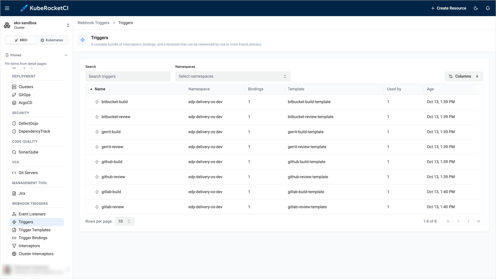

The list contains the following columns:

| Column | Description |
|:-|:-|
| **Name** | The Trigger name. For example, `github-build` runs the build pipeline after a pull request is merged, and `gitlab-review` runs the review pipeline for a merge request. The platform provides Triggers for each supported Git server, such as `bitbucket-build`, `gerrit-review`, and `github-build`. |
| **Namespace** | The namespace of the Trigger. |
| **Bindings** | The number of Trigger Bindings the Trigger uses. |
| **Template** | The Trigger Template that creates the pipeline run. |
| **Used by** | The number of Event Listeners that reference the Trigger. |
| **Age** | The date and time the Trigger was created. |

To find a Trigger, type its name in the **Search** field. If you have access to more than one namespace, use the **Namespaces** filter to show Triggers from specific namespaces only. To show or hide columns, click **Columns**.

Click a Trigger name to open its details. The **Overview** tab contains the following sections:

* **Metadata**: The creation date and the labels of the Trigger.
* **Bindings**: The Trigger Bindings the Trigger uses.
* **Template**: The Trigger Template the Trigger uses.
* **Interceptors**: The interceptors the Trigger runs, in the order they run, with their parameters. For example, the `github-build` Trigger uses the cluster interceptor `github` to validate the webhook secret and accept only `pull_request` events, and the cluster interceptor `cel` with the filter `body.action in ['closed'] && body.pull_request.merged == true` to run only after a merge. The namespaced `edp` interceptor then adds codebase data to the event.
* **Used by**: The Event Listeners that reference the Trigger.

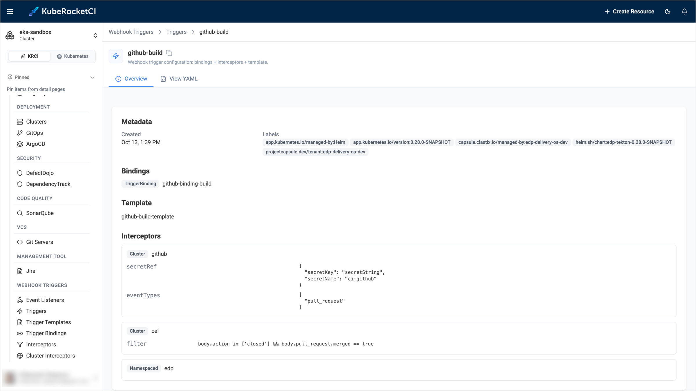

To see the full resource definition, open the **View YAML** tab.

## Trigger Templates

A Trigger Template is a blueprint of a Tekton `PipelineRun`. Whenever an Event Listener fires, the template creates a pipeline run and fills in its parameters with the values from the Trigger Binding. Open **Webhook Triggers** -> **Trigger Templates** to view the list.

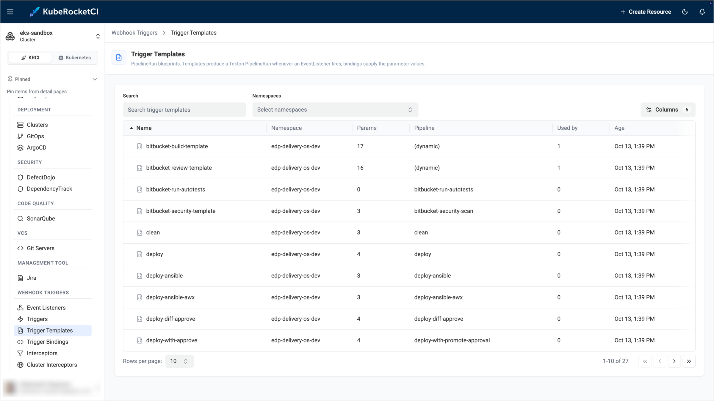

The list contains the following columns:

| Column | Description |
|:-|:-|
| **Name** | The Trigger Template name. |
| **Namespace** | The namespace of the Trigger Template. |
| **Params** | The number of parameters the template accepts. |
| **Pipeline** | The pipeline the template runs. The `(dynamic)` value means that the pipeline is not fixed in the template. It is selected for each codebase branch, and the template takes its name from the `pipelineName` parameter. The review and build templates for GitHub and GitLab work this way. |
| **Used by** | The number of Triggers that use the template. Templates with `0` are not referenced by any Trigger. |
| **Age** | The date and time the template was created. |

Click a template name to open its details. The **Overview** tab contains the following sections:

* **Metadata**: The creation date and the labels of the template.
* **Params**: The parameters of the template, with their descriptions and default values. For example, the `deploy` template accepts `CDPIPELINE`, `CDSTAGE`, `APPLICATIONS_PAYLOAD`, and `KUBECONFIG_SECRET_NAME`. In the review and build templates, the `pipelineName` parameter is the pipeline to run, which the KubeRocketCI interceptor populates from the codebase branch specification.
* **Resource templates**: The resources the template creates. Usually it is a `PipelineRun` that references a pipeline, either by name, as the `deploy` template does, or through the `pipelineName` parameter.
* **Used by**: The Triggers that use the template. If nothing references the template, the section shows **No Triggers or EventListeners reference this TriggerTemplate**.

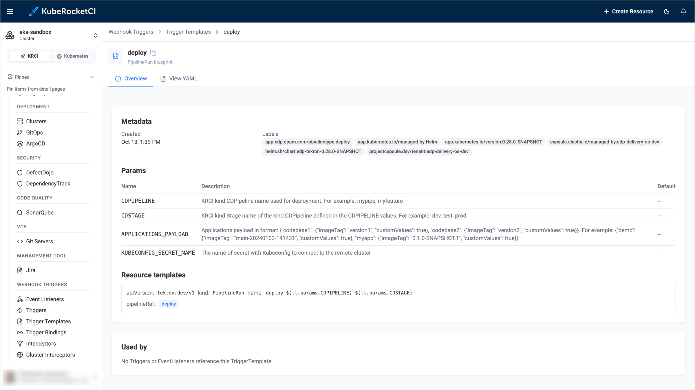

## Trigger Bindings

A Trigger Binding maps the fields of a webhook payload to the parameters of a Trigger Template. Open **Webhook Triggers** -> **Trigger Bindings** to view the list.

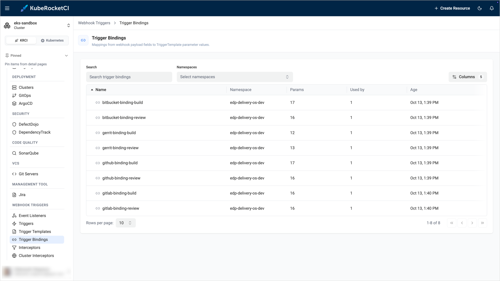

The list contains the following columns:

| Column | Description |
|:-|:-|
| **Name** | The Trigger Binding name. |
| **Namespace** | The namespace of the Trigger Binding. |
| **Params** | The number of parameters the binding sets. |
| **Used by** | The number of Triggers that use the binding. |
| **Age** | The date and time the binding was created. |

Click a binding name to open its details. The **Overview** tab contains the following sections:

* **Metadata**: The creation date and the labels of the binding.
* **Param mapping**: The name of each template parameter and the expression that provides its value. The `$(body.…)` expressions read values directly from the webhook payload. For example, `$(body.pull_request.head.ref)` is the source branch of the pull request. The `$(extensions.…)` expressions read values that the interceptors add to the event. For example, `$(extensions.codebasebranch)` is the codebase branch that the KubeRocketCI interceptor resolved.
* **Used by**: The Triggers that use the binding.

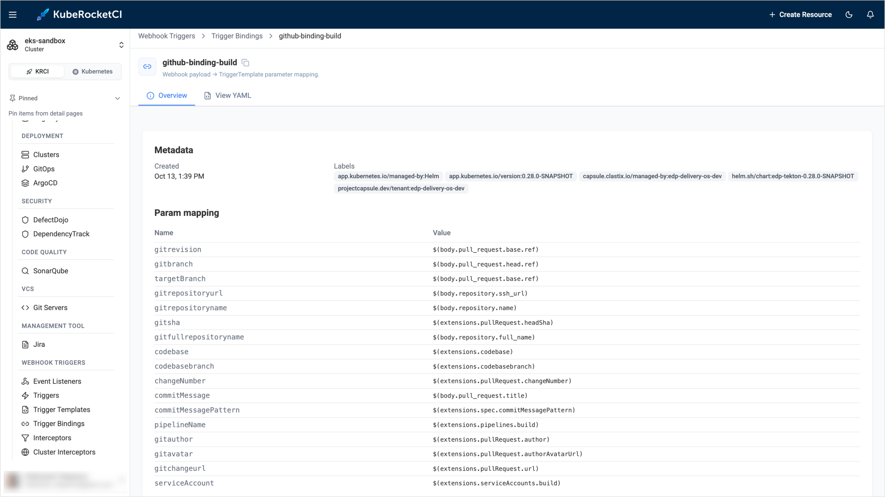

## Interceptors

An Interceptor is a namespaced HTTP service that processes a webhook before the binding and the template run. Open **Webhook Triggers** -> **Interceptors** to view the list.

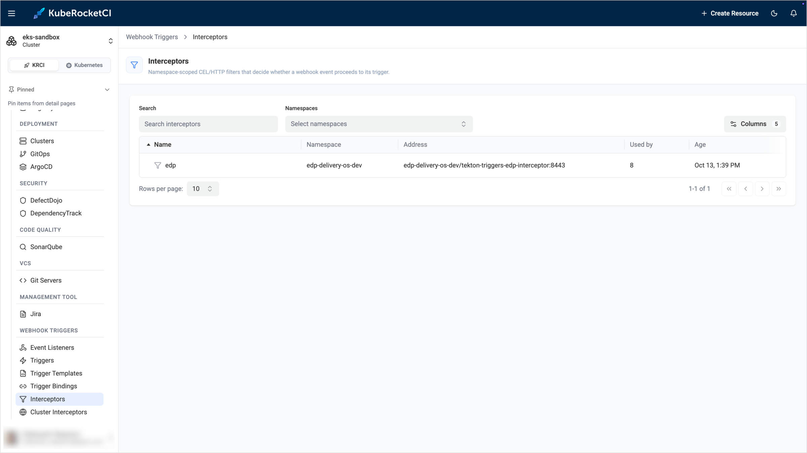

The list contains the following columns:

| Column | Description |
|:-|:-|
| **Name** | The Interceptor name. |
| **Namespace** | The namespace of the Interceptor. |
| **Address** | The service and port that receive the webhook, in the `<namespace>/<service>:<port>` format. |
| **Used by** | The number of Triggers that use the Interceptor. |
| **Age** | The date and time the Interceptor was created. |

The platform provides the `edp` Interceptor. It is served by the `tekton-triggers-edp-interceptor` service from the [edp-tekton](https://github.com/epam/edp-tekton) component. It enriches the webhook payload with the `Codebase` and `CodebaseBranch` data, the pipeline name, and the service account for the pipeline run. Triggers for GitHub and GitLab review and build pipelines use it.

Click an Interceptor name to open its details. The **Overview** tab contains the following sections:

* **Metadata**: The creation date and the labels of the Interceptor.
* **Client config**: The service, namespace, and port the Interceptor listens on.
* **Used by**: The Triggers that use the Interceptor.

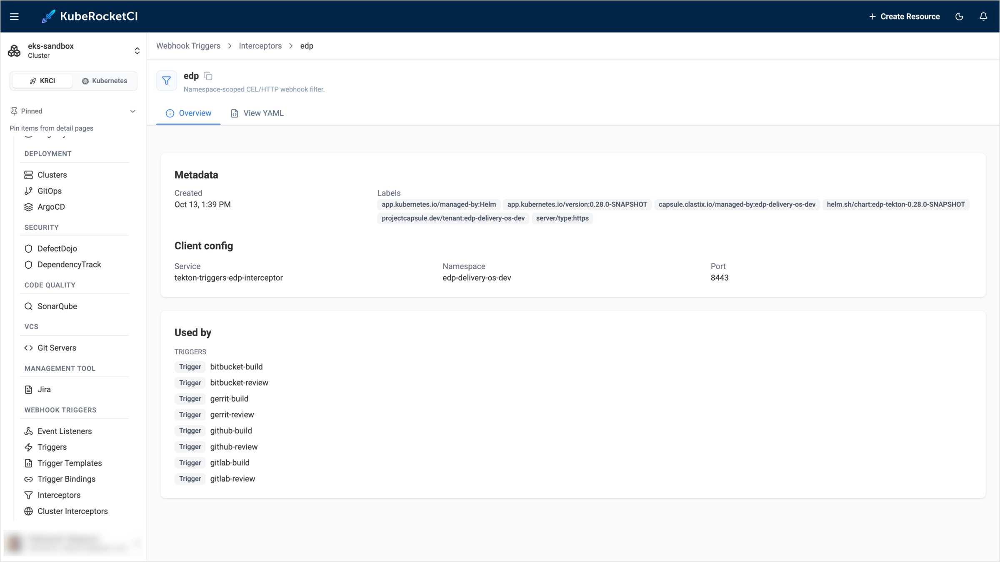

## Cluster Interceptors

A Cluster Interceptor is a cluster-scoped interceptor implementation shipped with Tekton Triggers. Triggers refer to them by name and pass their own parameters, for example the webhook secret or a CEL filter expression. Open **Webhook Triggers** -> **Cluster Interceptors** to view the list.

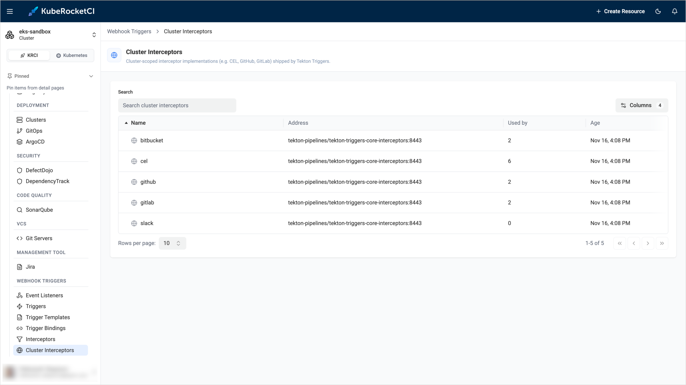

The list contains the **Name**, **Address**, **Used by**, and **Age** columns, which have the same meaning as in the Interceptors list. Tekton Triggers provides the `bitbucket`, `cel`, `github`, `gitlab`, and `slack` cluster interceptors. All of them are served by the `tekton-triggers-core-interceptors` service in the `tekton-pipelines` namespace. The `cel` interceptor evaluates the filter expressions, and the `github`, `gitlab`, and `bitbucket` interceptors validate the webhook secret and the event type.

Click a Cluster Interceptor name to open its details. The **Overview** tab shows the **Metadata**, the **Client config** with the service, namespace, and port, and the Triggers that use the interceptor in the **Used by** section.

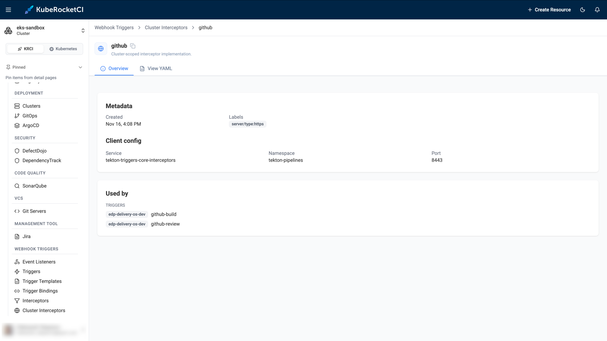

:::note
Cluster Interceptors are cluster-scoped resources. If your account does not have permission to read them, the page shows the message **Sorry. You don't have permissions to access this data.** In this case, contact a platform administrator.
:::

## Event Listeners

An Event Listener is the entry point for webhooks. It exposes an HTTP endpoint and passes every incoming event to its configured Triggers. Open **Webhook Triggers** -> **Event Listeners** to view the list.

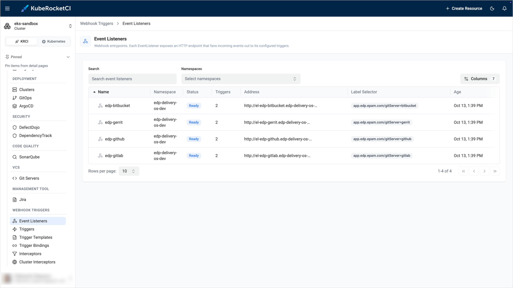

The list contains the following columns:

| Column | Description |
|:-|:-|
| **Name** | The Event Listener name. The platform creates an Event Listener for each Git server, for example `edp-github` and `edp-gitlab`. |
| **Namespace** | The namespace of the Event Listener. |
| **Status** | The state of the Event Listener. **Ready** means that it accepts webhooks. |
| **Triggers** | The number of Triggers the Event Listener runs. |
| **Address** | The in-cluster URL of the Event Listener service. |
| **Age** | The date and time the Event Listener was created. |

Click an Event Listener name to open its details. The page shows the following information:

* **Status and address**: The state of the Event Listener and its endpoint.
* **Triggers configured**: The number of Triggers the Event Listener runs.
* **Triggered runs · 24h**: The number of pipeline runs the Event Listener started in the last 24 hours.
* **Flow diagram**: The complete path of a webhook, from the Git source through the Event Listener, Triggers, Interceptors, Trigger Bindings, and Trigger Templates to the pipeline. Use the **Horizontal** and **Vertical** buttons to change the layout, and the zoom controls to move around the diagram.

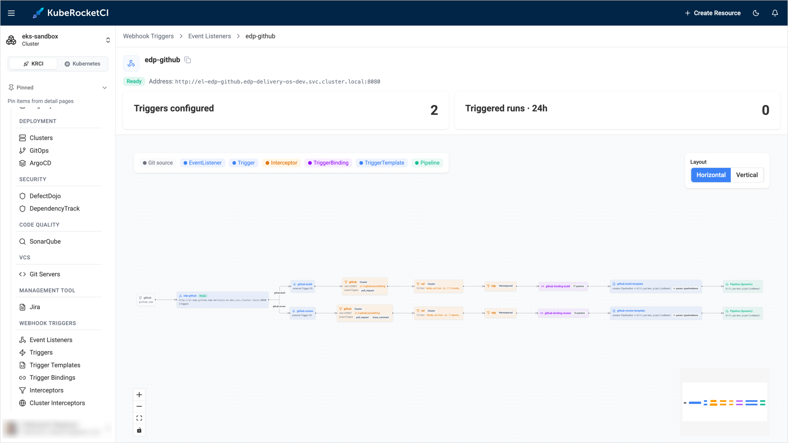

The diagram is the fastest way to answer questions such as why a pipeline did not start after a push or a comment. Find the Trigger for the event and check the interceptor filters on its path. For example, the review Trigger for GitHub accepts the `opened` and `synchronize` pull request actions, and comments only from the repository owners, members, and collaborators.

## Related Articles

* [Add Custom Tekton Triggers](customize-ci-triggers.md)
* [Tekton Overview](tekton-pipelines.md)
* [Configuration Overview](configuration-overview.md)
